# 🎵 MIORA

**Audiophile-Grade Android Native Music Player**  
*Your music. Your moments.*

[](https://mefahim.github.io/MIORA/)
[](https://github.com/mefahim/MIORA/releases/tag/v0.1.0-beta.1)
[](https://github.com/mefahim/MIORA/actions)
[](LICENSE)
[-green.svg)](https://android.com)

---

🌐 **Official Website & Interactive Showcase**: [https://mefahim.github.io/MIORA/](https://mefahim.github.io/MIORA/)

---

## ⚡ Quick Download

Download the official signed release binary directly from GitHub:

📦 **[Download MIORA v0.1.0-beta.1 APK](https://github.com/mefahim/MIORA/releases/download/v0.1.0-beta.1/MIORA-v0.1.0-beta.1.apk)**  
*(Size: ~17.1 MB • SHA-256 Checksum: `d125c381713f5b802ec2452733d8426ce90d8b2a8a7e0dd7ba69f923e28eed90`)*

---

## 🌟 Core Features

- 🎧 **Native Audio Playback Engine**: Complete Android `mediaPlayback` foreground service with seamless background playback, robust audio focus handling (ducking & phone call interruptions), and status bar / lockscreen transport controls.
- 🎨 **Dynamic Color Theming**: Automatically extracts vibrant accent palettes from album artwork in real-time, smoothly transitioning background surfaces while maintaining strict WCAG contrast compliance.
- 🗃️ **Persistent SQLite Playlist System**: High-performance SQLite database managing custom playlist creation, track ordering, deduplication, and bulk batch operations.
- 🖼️ **Unified Artwork Pipeline**: Three-tier artwork resolver extracting from MediaStore album art URIs, embedded ID3 tags, and deterministic algorithmic fallback seeds.
- 🔄 **Native In-App Update Engine**: Automatically checks GitHub Releases for new updates with channel selection (**Stable** vs. **Beta**), background downloading, cryptographic SHA-256 integrity verification, and one-tap installation via `FileProvider`.
- 100% **Clean-Room Engineering**: Completely reconstructed using open standards and independent architecture with zero proprietary code or assets.

---

## 🏛️ System Architecture

```mermaid
flowchart LR
    subgraph UI ["User Interface (Jetpack Compose)"]
        NowPlaying["Now Playing / MiniPlayer"]
        Library["Library & Folders"]
        Playlists["Playlists & Queue"]
        Settings["Settings & In-App Updater"]
    end

    subgraph Core ["Core Audio & Logic"]
        AudioEngine["PlaybackService & Manager"]
        PaletteEngine["DynamicPalette & ArtworkResolver"]
        UpdateEngine["UpdateManager & Checker"]
    end

    subgraph Data ["Persistence Layer"]
        SQLite["SQLite Playlist Store"]
        MediaStore["MediaStore Scanner"]
        DataStore["Settings Preferences"]
    end

    UI --> Core
    Core --> Data
```



Detailed architectural blueprints are available in **[docs/ARCHITECTURE.md](docs/ARCHITECTURE.md)**.

---

## 📚 Technical Documentation

- 🏛️ **[System Architecture](docs/ARCHITECTURE.md)**: Layered architecture, subsystem boundaries, and state flow.
- 🔄 **[In-App Update System](docs/IN_APP_UPDATES.md)**: Deep dive into the update checker, SemVer engine, and verification flow.
- 🚀 **[Release Procedures](docs/RELEASING.md)**: Guide to signing, versioning, tag management, and release publishing.
- 🔒 **[Security Policy](docs/SECURITY.md)**: Privacy principles and vulnerability disclosure guidelines.
- 📝 **[Changelog](CHANGELOG.md)**: Comprehensive record of all versions and additions.
- 🤝 **[Contributing Guidelines](CONTRIBUTING.md)**: Development setup and clean-room coding standards.

---

## 🔬 Phase 1 Deep Clean-Room Research Archive

This project originated from comprehensive clean-room reverse-engineering research and architectural specifications produced using REA (Reverse Engineer Anything), JADX, and static analysis tools.

- **Executive Summary**: **[PHASE-1-FINAL-REPORT.md](PHASE-1-FINAL-REPORT.md)**
- **Research Matrix**: 70 Features Audited across 8 functional categories.

All detailed technical research documents remain fully intact in the [`research/`](research/) directory:

| Index | Document Title | Focus |
| :---: | :--- | :--- |
| **00** | [Environment Readiness](research/00-ENVIRONMENT-READINESS.md) | REA, JADX, Apktool, ADB, JDK 17 environment audit |
| **01** | [APK Forensic Report](research/01-APK-FORENSIC-REPORT.md) | Cryptographic verification, manifest, native binaries |
| **02** | [REA Investigation Log](research/02-REA-INVESTIGATION-LOG.md) | Chronological REA reverse-engineering log |
| **03** | [Tech Stack Analysis](research/03-TECH-STACK-ANALYSIS.md) | Target stack vs. modern Android Jetpack Compose |
| **04** | [Feature Inventory](research/04-FEATURE-INVENTORY.md) | Exhaustive 70-feature matrix with evidence links |
| **05** | [Screen Inventory](research/05-SCREEN-INVENTORY.md) | Complete inventory of 66 declared Activities and modals |
| **06** | [Navigation Flow](research/06-NAVIGATION-FLOW.md) | Mermaid state navigation and lifecycle diagrams |
| **07** | [Monetization Analysis](research/07-PREMIUM-FEATURE-INVENTORY.md) | Analysis of licensing, trial engines, and IPC |
| **08** | [Code Path Deep Dive](research/08-CODE-PATH-ANALYSIS.md) | Reverse-engineered audio pipelines and filter math |
| **09** | [Runtime Observations](research/09-RUNTIME-OBSERVATIONS.md) | Hardware constraints, emulator testing, logcat |
| **10** | [Independent Architecture](research/10-INDEPENDENT-ARCHITECTURE.md) | Clean-room modular architecture & Biquad IIR math |
| **11** | [Product Requirements (PRD)](research/11-PRODUCT-REQUIREMENTS.md) | Functional and non-functional specifications |
| **12** | [Risk & Licensing Analysis](research/12-RISK-AND-LICENSING.md) | Clean-room boundaries and open-source licensing |
| **13** | [Implementation Roadmap](research/13-IMPLEMENTATION-ROADMAP.md) | Six-phase engineering execution plan |
| **14** | [Evidence Matrix](research/14-EVIDENCE-MATRIX.md) | Traceability matrix linking features to evidence |
| **15** | [Feature Audit Validation](research/15-FEATURE-AUDIT-VALIDATION.md) | Four-dimensional implementation audit |
| **16** | [QA Correction Log](research/16-QA-CORRECTION-LOG.md) | Quality assurance and consistency corrections |
| **17** | [Phase 1.2.1 Correction Report](research/17-PHASE-1.2.1-CORRECTION-REPORT.md) | Technical evidence corrections and DSP precision |
| **18** | [Phase 1.2.2 Final QA Report](research/18-PHASE-1.2.2-FINAL-QA-REPORT.md) | Baseline consistency review |
| **19** | [Phase 1.2.2.1 Certification](research/19-PHASE-1.2.2.1-FINAL-CERTIFICATION.md) | Link reconciliation and final baseline certification |
| **20** | [Phase 2 UI Implementation](research/20-PHASE-2-UI-IMPLEMENTATION-REPORT.md) | Jetpack Compose UI/UX implementation report |

---

## 🛠️ Building & Testing

### Run Unit Tests
```bash
./gradlew testDebugUnitTest --no-daemon
```
*(All 72 tests execute in under 1 second with 100% pass rate)*

### Build Debug APK
```bash
./gradlew assembleDebug --no-daemon
```
The output artifact will be generated at `app/build/outputs/apk/debug/app-debug.apk`.

---

## ⚖️ Clean-Room & Legal Compliance

To strictly adhere to intellectual property laws and clean-room engineering standards:
1. **Zero Code Copying**: No decompiled Smali, Java, or C/C++ code is copied or incorporated into this repository.
2. **Proprietary Assets Excluded**: Commercial APKs and copyrighted assets are strictly excluded via `.gitignore`.
3. **Independent Implementation**: All algorithms and components are reconstructed independently from public technical literature and standard Android APIs.

---

## 📄 License

This project and documentation are licensed under the **[Apache License 2.0](LICENSE)**.
