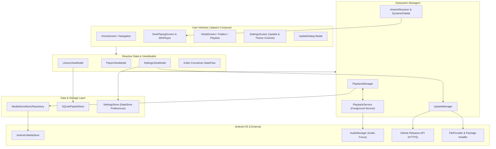

# MIORA Architecture & Engineering Specifications

This document outlines the software architecture, design patterns, subsystem boundaries, and technical decisions underpinning **MIORA** (v0.1.0-beta.1).

---

## 🏛️ System Overview

MIORA is an independent, audiophile-oriented Android native music player engineered from clean-room technical specifications. It combines modern Android Jetpack libraries with robust background audio management, high-performance artwork extraction, SQLite persistent storage, and a cryptographic in-app update subsystem.

---

## 🧩 Architectural Layers

### 1. Presentation Layer (Jetpack Compose & Material 3)
- **100% Declarative UI**: Engineered purely with Jetpack Compose, Material 3, and Kotlin Coroutines.
- **Dynamic Theming**: Utilizes `DynamicPalette` to extract dominant colors directly from album art or system wallpaper (Material You), with a deterministic non-purple fallback palette for OLED displays.
- **State Driven**: All UI components consume unidirectional data flows (`StateFlow`) and dispatch user actions via ViewModel functions.

### 2. Audio Engine & Service Layer (`com.fahim.powerampclone.playback`)
- **Foreground Service**: `PlaybackService` runs as an Android `mediaPlayback` foreground service ensuring uninterrupted background playback across process suspension and doze states.
- **Playback Controls & State**: `PlaybackManager` exposes thread-safe state flows (`currentTrack`, `isPlaying`, `playbackPosition`, `duration`, `playbackMode`, `queue`).
- **Audio Focus**: Automatically requests and manages audio focus (`AUDIOFOCUS_GAIN`), handling transient loss (ducking/pausing during incoming phone calls or GPS instructions) and focus regain.
- **Lockscreen & Notifications**: Emits system media playback notifications with transport controls (`ACTION_PLAY`, `ACTION_PAUSE`, `ACTION_SKIP_TO_NEXT`, `ACTION_SKIP_TO_PREVIOUS`, `ACTION_SEEK_TO`).

### 3. Unified Artwork Pipeline (`com.fahim.powerampclone.artwork`)
- **ArtworkResolver**: Three-tier resolution strategy:
  1. Primary: MediaStore album artwork URI (`content://media/external/audio/albumart/<id>`).
  2. Secondary: Embedded ID3 tag extraction via `MediaMetadataRetriever` on the local file.
  3. Tertiary: Fallback generative vector seed based on the track's deterministic numeric seed.
- **DynamicPalette**: Calculates vibrancy, lightness, and contrast-compliant surface/content color pairs to dynamically tint the player interface and mini-player.

### 4. Persistence Layer (`com.fahim.powerampclone.data.playlist`)
- **SQLite Database**: Native SQLite storage (`SQLitePlaylistStore`) managing playlist records and track associations with foreign keys, transactional batch operations, and custom track ordering indices.
- **DataStore Preferences**: `SettingsStore` persists theme choices, dynamic color toggles, crossfade preferences, and update channel settings.

### 5. In-App Update Engine (`com.fahim.powerampclone.update`)
- **Release Verification**: Queries GitHub REST API (`https://api.github.com/repos/mefahim/MIORA/releases`).
- **Semantic Versioning**: Full SemVer 2.0.0 parsing (`SemanticVersion`) with precedence rules (`0.1.0-beta.1` < `0.1.0`).
- **Channel Routing**: Supports `UpdateChannel.STABLE` and `UpdateChannel.BETA`.
- **Integrity Validation**: Computes streaming SHA-256 checksums to verify downloaded APK payloads prior to triggering installation.
- **Package Installer**: Validates APK package name matches `com.fahim.powerampclone`, pre-checks Android 8.0+ `canRequestPackageInstalls()`, and delegates to `FileProvider` and the Android system package installer.

---

## 🔒 Security Model

1. **No External Dependencies for Network/Security**: HTTP connections utilize standard Java `HttpURLConnection` over TLS 1.3 with standard Android trust roots.
2. **Package Identity Enforcement**: Downloaded APKs are inspected with Android's `PackageManager.getPackageArchiveInfo` before presenting an install prompt.
3. **Cryptographic Checksum Verification**: Every APK download is verified against SHA-256 hashes published in the release notes or companion `.sha256` asset files.
4. **Clean-Room Boundary**: Zero proprietary code, zero proprietary assets, and 100% independently created algorithms.
