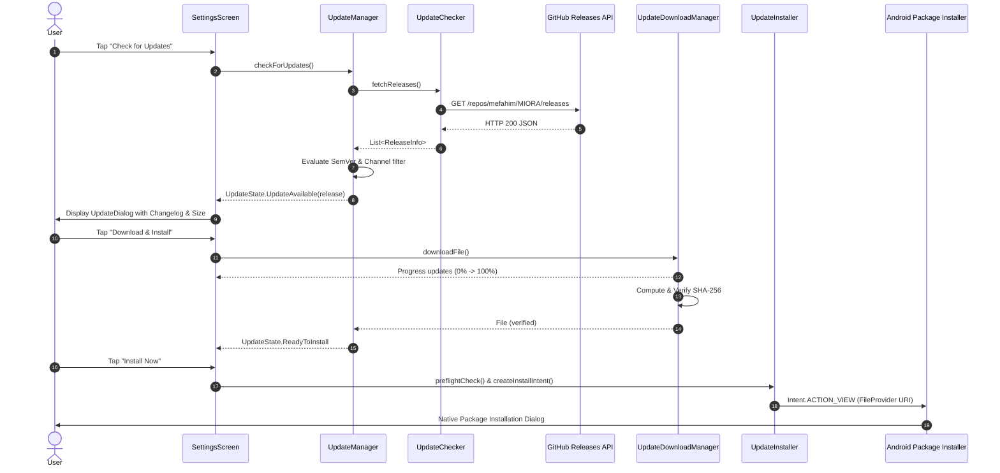

# Native In-App Update Subsystem

MIORA includes a built-in, native update subsystem designed for distributed APK installations outside the Google Play Store. It allows users to stay up-to-date with releases directly from the official GitHub repository.

---

## 🎯 Architecture & Data Flow



---

## 📡 Distribution Channels

MIORA supports two release distribution channels configurable in **Settings > App Updates > Update Channel**:

1. **Stable Channel (`UpdateChannel.STABLE`)**:
   - Only non-prerelease tags are evaluated (e.g. `v0.1.0`, `v1.0.0`).
   - Prereleases (`-beta.*`, `-alpha.*`, `-rc.*`) are completely ignored.
2. **Beta Channel (`UpdateChannel.BETA`)**:
   - Receives both stable releases and public beta builds.
   - Ideal for early testing and tracking the active development cycle.

---

## 🛡️ Integrity & Security Protections

### 1. Semantic Version Precedence
The updater strictly enforces SemVer 2.0.0 rules:
- An update is **only** offered if `remoteVersion > localVersion`.
- Equal versions (`0.1.0-beta.1` == `0.1.0-beta.1`) are treated as up-to-date.
- Downgrades (`remote < local`) are explicitly rejected to protect users against replay attacks.

### 2. SHA-256 Hash Validation
- During download, the APK file hash is calculated using `java.security.MessageDigest`.
- The computed hash is verified against:
  - The SHA-256 string embedded in the GitHub release notes, or
  - The companion `.sha256` asset uploaded with the release.
- If the hash does not match, the downloaded file is automatically deleted and an error dialog is presented.

### 3. Application Package Identity
Before launching the package installer, `UpdateInstaller.preflightCheck`:
- Verifies that the APK is readable and parseable.
- Verifies that `archiveInfo.packageName` strictly matches `com.fahim.powerampclone`.
- On Android 8.0+ (API 26+), verifies that the app has `REQUEST_INSTALL_PACKAGES` permission or redirects the user to the system permission screen.

---

## 📂 FileProvider Configuration

In `AndroidManifest.xml`:
```xml
<provider
    android:name="androidx.core.content.FileProvider"
    android:authorities="${applicationId}.fileprovider"
    android:exported="false"
    android:grantUriPermissions="true">
    <meta-data
        android:name="android.support.FILE_PROVIDER_PATHS"
        android:resource="@xml/file_paths" />
</provider>
```

In `res/xml/file_paths.xml`:
```xml
<paths xmlns:android="http://schemas.android.com/apk/res/android">
    <cache-path name="update_cache" path="updates/" />
    <external-cache-path name="update_external_cache" path="updates/" />
    <external-files-path name="update_external_files" path="updates/" />
</paths>
```
Downloads are stored in `context.cacheDir/updates/MIORA-<version>.apk` and shared with the system package installer using content URIs granted with `FLAG_GRANT_READ_URI_PERMISSION`.
