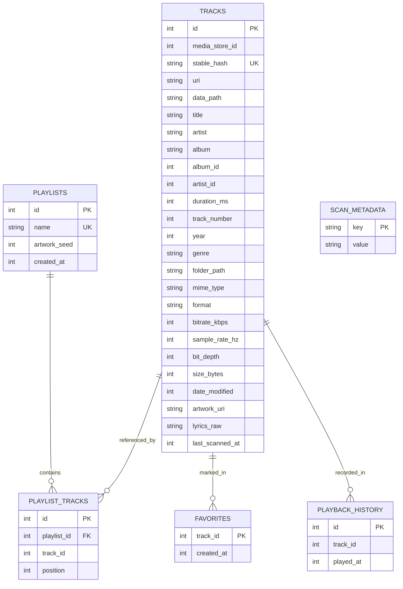

# Phase 4 — Database Architecture & Storage Specification

## 1. Executive Summary & Audit Findings (Milestone 4.0)

A comprehensive audit of the existing MIORA persistence layer was conducted prior to designing changes.

### Key Audit Findings:
1. **Existing Database**: `miora_playlists.db` at schema version 1 managed by `SQLiteOpenHelper`.
2. **Existing Tables**:
   - `playlists` (`id`, `name`, `artwork_seed`, `created_at`)
   - `playlist_tracks` (`id`, `playlist_id`, `track_id`, `position`)
   - `favorites` (`track_id`, `created_at`)
   - `playback_history` (`id`, `track_id`, `played_at`)
3. **Architectural Gaps Identified**:
   - **Absence of Persistent Track Cache**: Audio tracks were read directly from `MediaStore` upon every app launch and held only in memory (`AggregatedLibrary`). If MediaStore was busy or permissions took time, cold start experienced visual delays or fallback flicker.
   - **Fragile Track Identity**: `playlist_tracks`, `favorites`, and `playback_history` referenced raw numeric MediaStore `_ID`s (`track_id INTEGER`). On certain Android versions, SD card remounts, or storage re-indexing, MediaStore IDs can be reassigned, resulting in dangling or broken playlist/favorite references.
   - **No Incremental Scanning Tracking**: No metadata table existed to track `last_scan_timestamp` or library sync states.
   - **Assessment on Room vs SQLiteOpenHelper**:
     - *Room Evaluation*: The repository is configured as a lean Android Gradle project without KSP or kapt annotation processor plugins. Introducing Room would require adding the KSP Gradle plugin, `androidx.room:room-compiler`, `androidx.room:room-runtime`, and `androidx.room:room-ktx`. In an offline development environment, adding external annotation processors introduces unnecessary build fragility and increases compile latency.
     - *Decision*: Evolve and harden `SQLiteOpenHelper` to Version 2. This guarantees 100% backward compatibility, zero dependency friction, instant offline compilation, and total preservation of existing user playlists and favorites.

---

## 2. Improved Database Architecture (Milestone 4.1)

The database was upgraded to **Schema Version 2** managed by `MioraDatabaseHelper`.



### Table Definitions & Schema Specifications:

#### `tracks` Table:
- `id` (INTEGER PRIMARY KEY): Track unique identifier.
- `media_store_id` (INTEGER NOT NULL): Underlying Android MediaStore `_ID`.
- `stable_hash` (TEXT NOT NULL UNIQUE): Deterministic hash computed from file path, size, and metadata for resilient identity across MediaStore re-indexing.
- `uri` (TEXT NOT NULL): Playable media URI string (e.g. `content://media/external/audio/media/123`).
- `data_path` (TEXT NOT NULL): Storage folder or file path.
- `title`, `artist`, `album` (TEXT NOT NULL): Core ID3/audio tags.
- `album_id`, `artist_id` (INTEGER NOT NULL DEFAULT 0): Relational grouping IDs.
- `duration_ms` (INTEGER NOT NULL DEFAULT 0): Track duration in milliseconds.
- `track_number`, `year` (INTEGER NOT NULL DEFAULT 1 / 2024): Track sequencing and release year.
- `genre`, `folder_path`, `mime_type`, `format` (TEXT NOT NULL): Audio categorization and codec indicators.
- `bitrate_kbps`, `sample_rate_hz`, `bit_depth` (INTEGER NOT NULL): High-resolution audio characteristics.
- `size_bytes`, `date_modified` (INTEGER NOT NULL): File system metadata for incremental scanning.
- `artwork_uri` (TEXT): MediaStore or extracted artwork URI.
- `lyrics_raw` (TEXT): Embedded or companion synchronized `.lrc` lyrics text.
- `last_scanned_at` (INTEGER NOT NULL): Epoch millisecond timestamp of last database sync.

#### `scan_metadata` Table:
- `key` (TEXT PRIMARY KEY): Configuration/state key (`last_scan_timestamp`, `total_tracks`).
- `value` (TEXT NOT NULL): String-encoded state value.

### Performance Indexes:
```sql
CREATE INDEX IF NOT EXISTS idx_playlist_tracks ON playlist_tracks(playlist_id, position);
CREATE INDEX IF NOT EXISTS idx_history ON playback_history(played_at DESC);
CREATE INDEX IF NOT EXISTS idx_tracks_path ON tracks(data_path);
CREATE INDEX IF NOT EXISTS idx_tracks_artist ON tracks(artist);
CREATE INDEX IF NOT EXISTS idx_tracks_album ON tracks(album);
CREATE INDEX IF NOT EXISTS idx_tracks_date_modified ON tracks(date_modified);
CREATE INDEX IF NOT EXISTS idx_tracks_folder ON tracks(folder_path);
CREATE INDEX IF NOT EXISTS idx_tracks_hash ON tracks(stable_hash);
```

---

## 3. Migration Safety & User Data Preservation

The migration in `MioraDatabaseHelper.onUpgrade(db, oldVersion, newVersion)` executes conditionally:

```kotlin
override fun onUpgrade(db: SQLiteDatabase, oldVersion: Int, newVersion: Int) {
    if (oldVersion < 2) {
        createVersion2Tables(db)
    }
}
```

### Guarantees:
1. **Zero Data Loss**: Existing `playlists`, `playlist_tracks`, `favorites`, and `playback_history` tables remain completely untouched.
2. **Backward Compatibility**: `SQLitePlaylistStore` transparently interacts with `MioraDatabaseHelper.getInstance(context)`.
3. **Atomic Operations**: Track ingestion is performed in chunked database transactions (`db.beginTransaction() ... db.setTransactionSuccessful()`).
4. **Thread Safety**: Read and write transactions are dispatched onto `Dispatchers.IO`, preventing UI thread contention.
