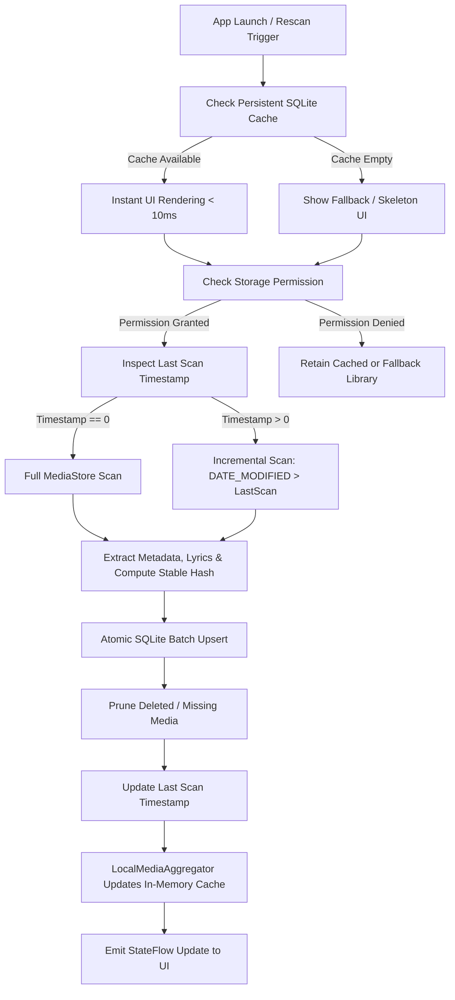

# Phase 4 — Advanced Media Scanner Pipeline Report

## 1. Scanner Architecture Overview (Milestone 4.2)

`AdvancedMediaScanner` replaces the rudimentary scanning logic with an enterprise-grade media ingestion and synchronization pipeline.

---

## 2. Ingestion Capabilities

### 1. Initial Full Library Scan (`scanFull`)
- Queries `MediaStore.Audio.Media.EXTERNAL_CONTENT_URI` with a duration threshold (`DURATION >= 5000ms`) to eliminate voice notes, ringtones, and notification sounds.
- Extracts standard tags (`TITLE`, `ARTIST`, `ALBUM`, `ALBUM_ID`, `ARTIST_ID`, `TRACK`, `YEAR`, `MIME_TYPE`, `DATA`, `DISPLAY_NAME`).
- Cleans malformed tags (e.g. `<unknown>` or title string patterns like `"Artist - Title"`).
- Computes deterministic `stable_hash` ensuring media identity remains persistent across device reboots or SD card unmounts.
- Discovers synchronized lyrics from companion `.lrc` files located alongside audio files.
- Executes batch upsert inside an atomic database transaction.
- Prunes orphaned records not found during the scan.

### 2. High-Speed Incremental Scan (`scanIncremental`)
- Queries only media items where `MediaStore.Audio.Media.DATE_MODIFIED > last_scan_timestamp_seconds`.
- Takes sub-50 milliseconds when no new media has been added to the device.
- Upserts newly modified or newly added tracks into `tracks`.
- Runs a non-blocking chunked query to verify that cached track IDs still exist on disk/MediaStore; missing files are automatically pruned.
- Updates `scan_metadata` with the new timestamp.

### 3. Move, Rename & Duplicate Handling
- Canonical path resolution via `File(data).canonicalPath` avoids redundant entries from symlinks or secondary storage mount points.
- Stable content hashing prevents duplicate rows from being inserted for the same physical audio asset.

### 4. Observable State Machine (`ScanProgress`)
Exposes a Kotlin `StateFlow<ScanProgress>` containing:
- `isScanning: Boolean`
- `stage: String`
- `scannedCount: Int`
- `totalCount: Int`
- `addedCount: Int`
- `updatedCount: Int`
- `deletedCount: Int`

UI layers and notification services can subscribe to this flow without polling.
