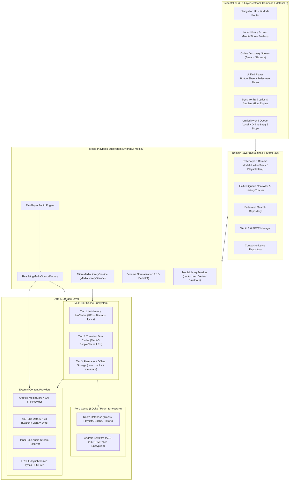

# MIORA NEXT — Target System Architecture Specification

- **Audit & Architecture Date:** November 12, 2026
- **Architect:** Antigravity Engineering & Architecture Team
- **Target Release:** MIORA Next (v1.0.0 Hybrid Music Engine)
- **Application ID:** `com.fhf.miora`

---

## 1. High-Level Architectural Blueprint

MIORA Next bridges the gap between audiophile-grade offline local audio playback and continuous online streaming. It eliminates artificial barriers between local files and online streams while maintaining clean architecture, strict security standards, and modular separation of concerns.



---

## 2. Core Subsystems Specification

### 2.1 Unified Domain Model (`PlayableItem` / `UnifiedTrack`)
To seamlessly support local and online audio without duplicate UI screens or playback hacks, MIORA Next introduces a single, polymorphic domain representation:

```kotlin
sealed interface AudioSource {
    data class LocalFile(
        val contentUri: Uri,
        val filePath: String,
        val mimeType: String,
        val sampleRate: Int,
        val bitDepth: Int,
        val isHiRes: Boolean
    ) : AudioSource

    data class OnlineStream(
        val videoId: String,
        val directStreamUrl: String? = null,
        val audioQuality: AudioQuality = AudioQuality.HIGH,
        val loudnessDb: Float? = null,
        val perceptualLoudnessDb: Float? = null,
        val expiryTimestamp: Long? = null
    ) : AudioSource

    data class CachedOffline(
        val cacheKey: String,
        val originalSource: AudioSource,
        val localFilePath: String
    ) : AudioSource
}

data class UnifiedTrack(
    val id: String,                 // Unique stable ID (URI hash or videoId)
    val title: String,
    val artist: String,
    val album: String?,
    val durationMs: Long,
    val artworkUri: Uri?,
    val source: AudioSource,
    val dateAdded: Long = System.currentTimeMillis()
)
```

---

### 2.2 Playback Subsystem (`MioraMediaLibraryService`)
- **Base Class:** `androidx.media3.session.MediaLibraryService`.
- **Core Player:** `androidx.media3.exoplayer.ExoPlayer`.
- **Dynamic Stream Resolution via `ResolvingDataSource`:**
  ExoPlayer is initialized with a custom `ResolvingDataSource.Factory` that translates abstract `mediaId` keys to playable stream URLs on-demand:
  ```kotlin
  val resolvingDataSourceFactory = ResolvingDataSource.Factory(
      cacheDataSourceFactory
  ) { dataSpec ->
      val mediaId = dataSpec.key ?: dataSpec.uri.toString()
      when {
          dataSpec.uri.scheme == "content" || dataSpec.uri.scheme == "file" -> {
              // Direct local file playback; zero transformation
              dataSpec
          }
          dataSpec.uri.scheme == "miora-online" -> {
              val videoId = dataSpec.uri.host ?: mediaId
              // 1. Check transient playerCache
              // 2. Check streamUrlCache (valid TTL)
              // 3. Resolve stream via InnerTubeX / Proxy resolver
              val resolvedUrl = streamResolver.resolveStreamUrl(videoId)
              dataSpec.buildUpon().setUri(resolvedUrl.toUri()).build()
          }
          else -> dataSpec
      }
  }
  ```
- **Audio Processing Sink:**
  - Includes a `VolumeNormalizationAudioProcessor` to adjust track gain based on track ReplayGain tags (for local files) or `loudnessDb` (from online streams).
  - Integrates a 10-band graphic equalizer with presets (Rock, Pop, Classical, Flat, Bass Boost) and virtualizer effects.

---

### 2.3 Multi-Tier Cache Hierarchy
To ensure instant track start times, zero stuttering on spotty networks, and offline independence, MIORA Next implements four tiers of caching:

```
[ ExoPlayer Buffer Request ]
         |
         v
+-----------------------------+
| Tier 1: In-Memory LruCache  |  -> Valid resolved stream URLs (TTL: 10m)
+-----------------------------+     Artwork Bitmaps, Parsed LRC Objects
         | (Miss)
         v
+-----------------------------+
| Tier 2: Transient Disk Cache|  -> Media3 SimpleCache (200MB - 1GB LRU)
+-----------------------------+     Automatic chunk buffering for playing tracks
         | (Miss)
         v
+-----------------------------+
| Tier 3: Download Storage    |  -> Permanent offline storage (.exo files + Room)
+-----------------------------+     User-pinned tracks, albums, and playlists
         | (Miss)
         v
+-----------------------------+
| Tier 4: Remote Resolution   |  -> Network stream resolution (InnerTube / Proxy)
+-----------------------------+     Downloads new audio chunks to Tier 2
```

---

### 2.4 Data & Persistence Subsystem (`MioraDatabase`)
MIORA Next migrates its SQLite database to a structured Room architecture:
- `tracks`: Metadata for both local and online tracks (id, title, artist, album, duration, source_type).
- `playlists`: User-created and synced playlists.
- `playlist_tracks`: Cross-reference junction table preserving ordered track sequences.
- `playback_history`: Real-time playback history with play duration and timestamps.
- `online_search_cache`: 24-hour cached search queries to preserve API quotas.
- `lyrics_cache`: Cached plain and synchronized lyrics mapped by track fingerprint.
- `download_records`: Tracks download state (DOWNLOADING, COMPLETED, FAILED), storage byte count, and format info.

---

### 2.5 Security, Cryptography & Authentication Architecture
MIORA Next strictly avoids raw session cookie sniffing. It maintains enterprise-grade security:
1. **OAuth 2.0 PKCE (RFC 7636):**
   - Implemented via `AppAuth-Android` or custom secure HTTP client.
   - Generates high-entropy cryptographic `code_verifier` and SHA-256 `code_challenge`.
   - Never exposes client secrets in client binaries.
2. **Hardware-Backed Android Keystore Encryption:**
   - Access tokens and refresh tokens are encrypted using AES-256-GCM.
   - Master key is generated inside Android Keystore (`AndroidKeyStoreProvider`) with authenticated hardware backing (StrongBox where available).
   - IVs are generated randomly per write operation; authenticated tags prevent tampering.
3. **Automatic Token Refresh Loop:**
   - Background token refresher automatically rotates expired access tokens seamlessly before outbound API calls.

---

### 2.6 Presentation & UI Design System
- **Framework:** 100% Jetpack Compose using Material Design 3.
- **Dynamic Palette Theming:**
  - `DynamicGlowCard.kt`: Extracts vibrant and muted dominant colors from track artwork using `androidx.palette.graphics.Palette`.
  - Renders smooth, hardware-accelerated animated gradient meshes behind player controls and lyrics displays.
- **Unified Player BottomSheet:**
  - Smooth gesture-driven bottom sheet transitions from persistent Mini-Player to Full-Screen Now-Playing view.
  - Consistent controls for local tracks (bitrate/format badges, e.g. "FLAC 24-bit/96kHz") and online tracks (streaming quality badges, e.g. "Opus 160kbps").
- **Synchronized Lyrics Display:**
  - Auto-scrolling, karaoke-style active lyric line highlighting with smooth spring animations.
  - Tap any lyric line to instantly seek playback to that exact timestamp.
