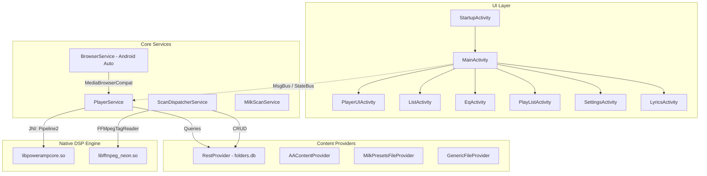

# 01 — APK Forensic & Static Analysis Report

## 1. Artifact Identification & Cryptographic Signatures

| Parameter | Observed Forensic Metric |
| :--- | :--- |
| **File Name** | `poweramp-music-player-build-1035-uni.apk` |
| **Absolute Local Path** | `/workspace/poweramp-clone/poweramp-music-player-build-1035-uni.apk` |
| **File Size** | `24,481,502` bytes (~23.35 MB) |
| **Cryptographic Hash (SHA-256)** | `3feff56552e2d3eeb4f58dc93b33db3d9895e22ad7638cd9feda3fa162cd307f` |
| **Integrity State** | Unmodified, verified against original baseline |
| **Distribution Type** | Universal Fat APK (`uni`) containing multi-ABI native binaries |

---

## 2. Package Identity & Platform Targeting

| Manifest Declaration | Value | Implication / Analysis |
| :--- | :--- | :--- |
| **Package Name** | `com.maxmpz.audioplayer` | Official Poweramp application identifier |
| **Shared User ID** | `com.maxmpz` | Enables shared Linux UID IPC with companion apps (`com.maxmpz.audioplayer.unlock`) |
| **Shared User Max SDK** | `32` (Android 12L) | Scoped to legacy platforms before Android 13 sharedUserId deprecation |
| **Version Name** | `build-1035-uni` | Build 1035 universal release |
| **Version Code** | `1035009` | Incremental integer build code |
| **Minimum SDK** | `21` (Android 5.0 Lollipop) | Requires API 21+ (ensures 64-bit runtime, MediaSession, AudioTrack float) |
| **Target SDK** | `36` (Android 16 Developer Preview) | Fully aligned with modern foreground service, notification, and storage policies |
| **Compile SDK** | `36` (Codename: 16) | Compiled against Android API 36 platform stubs |
| **Install Location** | `auto` | Allows moving app data/APK across internal/external storage |

---

## 3. Hardware & System Features Declared

```xml
<uses-feature android:name="android.hardware.touchscreen" android:required="false"/>
<uses-feature android:glEsVersion="0x20000" android:required="true"/>
<uses-feature android:name="android.hardware.usb.host" android:required="false"/>
<uses-feature android:name="android.software.companion_device_setup" android:required="false"/>
```

- **OpenGL ES 2.0 (`0x20000`)**: Required for Milkdrop visualization rendering, custom UI shaders, and waveform hardware acceleration.
- **USB Host (`android.hardware.usb.host`)**: Enables direct USB DAC OTG audio streaming and hardware endpoint communication.
- **Touchscreen Optional**: Allows installation on Android TV, automotive heads-up displays, and dedicated digital audio players (DAPs) with hardware button navigation.

---

## 4. Declared Permissions Inventory

The application requests **24 system permissions**, grouped by functional domain:

### A. Storage & File Access
1. `android.permission.MANAGE_EXTERNAL_STORAGE`: Scoped for Android 11+ (API 30+) to scan all audio files, CUE sheets, and LRC files across internal/external storage.
2. `android.permission.WRITE_EXTERNAL_STORAGE`: Legacy file writing for tag editing and playlist export on Android 10 and below.

### B. Audio & Media Execution
3. `android.permission.MODIFY_AUDIO_SETTINGS`: Direct volume modification, audio routing, and audio effect configuration.
4. `android.permission.WAKE_LOCK`: Prevents CPU deep sleep while audio decoding and playback pipelines are active.
5. `android.permission.FOREGROUND_SERVICE`: Essential for persistent background audio playback.
6. `android.permission.FOREGROUND_SERVICE_MEDIA_PLAYBACK`: Explicit Android 14+ foreground service type for media players.
7. `android.permission.FOREGROUND_SERVICE_CONNECTED_DEVICE`: Explicit Android 14+ foreground service type for Bluetooth / USB DAC audio streaming.

### C. Connectivity & External Device Control
8. `android.permission.BLUETOOTH`: Legacy Bluetooth connection state monitoring.
9. `android.permission.BLUETOOTH_CONNECT`: Android 12+ (API 31+) permission to detect Bluetooth headphones and query A2DP codec parameters.
10. `android.permission.BLUETOOTH_ADMIN`: Manage Bluetooth device connections and profile routing.
11. `android.permission.INTERNET`: Downloading album artwork, Chromecast streaming, online lyrics search, and licensing validation.
12. `android.permission.ACCESS_NETWORK_STATE`: Detecting Wi-Fi vs mobile network for Cast streaming and art downloads.

### D. User Interface & Hardware Controls
13. `android.permission.POST_NOTIFICATIONS`: Android 13+ (API 33+) requirement for displaying media player playback notification.
14. `android.permission.DISABLE_KEYGUARD`: Optional lock screen player widget integration.
15. `android.permission.SYSTEM_ALERT_WINDOW`: Floating lyrics / lock screen overlay display.
16. `android.permission.VIBRATE`: Haptic feedback when turning rotary knobs (EQ, Volume, Bass, Treble).
17. `android.permission.SET_VOLUME_KEY_LONG_PRESS_LISTENER`: Listening for long volume button presses to skip tracks when screen is off.
18. `com.android.launcher.permission.INSTALL_SHORTCUT`: Homescreen shortcuts for playlists, albums, and genres.
19. `com.sony.walkman.volumectrlpanel.PERM_MASTER_VOLUME`: Dedicated high-resolution volume control panel integration on Sony Walkman DAP devices.

### E. IPC & Integrations
20. `com.android.vending.BILLING`: Google Play In-App Billing for full version unlock.
21. `moe.shizuku.manager.permission.API_V23`: Shizuku privileged API access to disable Android Bluetooth Absolute Volume for Direct Volume Control (DVC).
22. `com.maxmpz.audioplayer.DYNAMIC_RECEIVER_NOT_EXPORTED_PERMISSION`: Android 14 dynamic receiver protection.
23. `android.permission.BROADCAST_STICKY`: Sticky playback status broadcasts for third-party widget/car integration.

### F. Custom App-Defined Permissions
24. `com.maxmpz.audioplayer.permission.ACCESS_MILK_PRESETS`: Protection level `dangerous` for third-party access to imported Milkdrop visualizer presets.

---

## 5. Architectural Component Summary

```
Total Components Declared in Manifest: 99
├── Activities: 66
├── Services: 10
├── Broadcast Receivers: 15
└── Content Providers: 8
```

### Manifest Component Topology



---

## 6. DEX & Class Topology

| Component | Metric | Notes |
| :--- | :--- | :--- |
| **DEX File Count** | 2 | `classes.dex` (6.33 MB), `classes2.dex` (0.47 MB) |
| **Total Classes** | 6,377 | Parsed top-level and inner classes |
| **Total Resources** | 3,380 | Decoded layouts, values, drawables, XML configs |
| **Proprietary Classes (`com.maxmpz.*`)** | 407 | Core player, DSP bridge, UI engine, preferences |
| **Obfuscated Core (`p000.*`)** | 1,244 | Obfuscated business logic, database migrations (`ar.java`, `po0.java`) |
| **Third-Party Libraries** | 4,726 | RuStore, Billing, AndroidX, OkHttp, Kotlin stdlib |

---

## 7. Native Shared Libraries Analysis

Two native libraries are present across two ARM architectures:

| Library Path | Architecture | File Size | Identified Role |
| :--- | :--- | :--- | :--- |
| `lib/arm64-v8a/libffmpeg_neon.so` | ARM 64-bit | 2,220,424 B | Custom NEON-optimized FFmpeg decoding engine |
| `lib/arm64-v8a/libpowerampcore.so` | ARM 64-bit | 4,630,560 B | Floating-point DSP core (64-bit double filter coefficients, float PCM buffers, DVC, resamplers, Milkdrop OpenGL) |
| `lib/armeabi-v7a/libffmpeg_neon.so` | ARM 32-bit | 2,486,096 B | 32-bit ARM fallback for legacy devices |
| `lib/armeabi-v7a/libpowerampcore.so` | ARM 32-bit | 3,731,760 B | 32-bit ARM fallback for legacy devices |

---

## 8. Third-Party Library Fingerprints

| Fingerprint / Namespace | Version / Artifact | Role in Target APK |
| :--- | :--- | :--- |
| `com.android.billingclient` | Google Play Billing Client | In-App purchase verification |
| `ru.rustore.sdk.pay` | RuStore Pay SDK | Alternative payment provider for Russian app market |
| `com.google.android.gms.cast` | Google Cast Framework | Chromecast audio streaming |
| `moe.shizuku.manager` | Shizuku API client | Elevated system settings modification (Absolute Volume toggling) |
| `okhttp3` / `okio` | Square OkHttp | HTTP network transport for lyrics, artwork, and licensing |
| `androidx.profileinstaller` | AndroidX ProfileInstaller | Baseline profile installation for fast startup |
| `androidx.media` | Support MediaCompat | `MediaSessionCompat` and `MediaBrowserServiceCompat` integration |

---

## 9. Forensic Conclusion
The target APK represents a highly specialized native Android audio reproduction application. Unlike typical modern Android applications that rely on Android framework View hierarchies and standard media players (MediaPlayer / ExoPlayer), this application features:
1. A **completely proprietary C++ audio processing core** (`libpowerampcore.so`).
2. A **custom NEON-accelerated FFmpeg decoding pipeline** (`libffmpeg_neon.so`).
3. An **in-house custom UI layout engine** (`com.maxmpz.widget.*`) driving OpenGL shaders and custom canvas rendering.
4. A **deep SQLite relational database** (`folders.db`, schema version 251) supporting multi-artists, CUE sheets, and FTS4 preference search.
