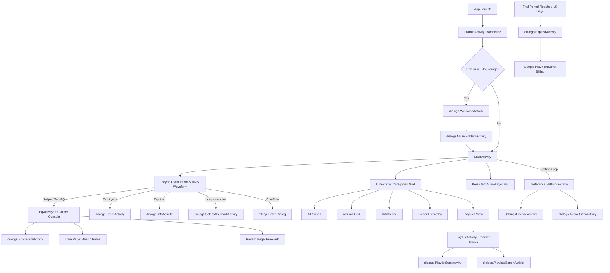

# 05 — Comprehensive Screen & Component Classification

## 1. Overview & Activity Taxonomy
The target application declares **66 distinct activities** in `AndroidManifest.xml`. Under Phase 1.1 architectural hardening, these 66 activities are audited and categorized into 6 functional classifications. 

> [!IMPORTANT]
> Of the 66 declared activities, **only 8 are persistent user-facing screen containers**. The remaining 58 components represent modal dialog sheets (22), widget configuration wizards (6), payment and licensing gateways (8), third-party integration endpoints (5), and internal routing trampolines or dynamic launcher aliases (17).

```
Total Declared Activity Components: 66
├── USER_FACING_SCREEN: 8
├── DIALOG_OR_SHEET: 22
├── WIDGET_CONFIGURATION: 6
├── PAYMENT_OR_LICENSING: 8
├── THIRD_PARTY_INTEGRATION: 5
├── INTERNAL_ACTIVITY (Trampolines & Aliases): 17
└── UNKNOWN: 0
```

---

## 2. Detailed Component Classification Matrix

### Category 1: USER_FACING_SCREEN (8 Components)
Interactive, primary destination containers hosting the main application UI tree:

| Activity Name | Launch Mode | Exported | Navigation / Visual Responsibility |
| :--- | :--- | :--- | :--- |
| `MainActivity` | `singleTask` | `true` | Root container hosting Main Player, Library Browser, and persistent Mini-Player |
| `PlayerUIActivity` | `standard` | `true` | Dedicated fullscreen playback window with large album art and RMS waveform |
| `ListActivity` | `standard` | `true` | Category list/grid view (All Songs, Albums, Artists, Genres, Folders) |
| `PlayListActivity` | `standard` | `true` | Playlist content manager with drag-and-drop track reordering |
| `EqActivity` | `standard` | `true` | Studio Equalizer console (Graphic/Parametric bands, Bass/Treble dials, Reverb) |
| `USBMainActivity` | `singleTask` | `true` | Hardware DAC exclusive-mode player interface |
| `preference.SettingsActivity` | `standard` | `true` | Hierarchical preference dashboard with full-text search |
| `SettingsActivity` | `standard` | `true` | Backward-compatibility entry point routing into `preference.SettingsActivity` |

### Category 2: DIALOG_OR_SHEET (22 Components)
Contextual modal sheets, bottom drawers, and transient configuration dialogs:

| Activity Name | Theme / UI Style | Functional Purpose |
| :--- | :--- | :--- |
| `dialogs.WelcomeActivity` | Onboarding Dialog | First-launch permissions walkthrough and storage directory selection |
| `dialogs.MusicFoldersActivity` | SAF Directory Picker | Storage folder checklist and SAF tree permission grant manager |
| `dialogs.InfoActivity` | Technical Dialog | Stream inspection (Container, Codec, Bitrate, Sample Rate, Bit Depth) |
| `dialogs.AudioInfoActivity` | Diagnostics Dialog | Deep audio engine stats (AudioTrack buffer latency, DSP underruns, DVC state) |
| `dialogs.EditTagActivity` | Editor Sheet | In-app audio metadata editor (Title, Artist, Album, Year, Genre, Track #) |
| `dialogs.LyricsActivity` | Lyrics Sheet | Synchronized LRC scroller, manual timestamp offset, and external app links |
| `dialogs.SelectAlbumArtActivity` | Image Picker Sheet | Local artwork chooser, cache manager, and online image search |
| `dialogs.EqPresetsActivity` | Selector Sheet | Equalizer preset browser, AutoEq profile search, and preset import |
| `dialogs.AddEqPresetActivity` | Text Dialog | Naming and saving newly constructed graphic or parametric EQ curves |
| `dialogs.AddReverbPresetActivity` | Text Dialog | Naming and saving custom algorithmic room acoustics presets |
| `dialogs.EqPresetAssignActivity` | Assignment Sheet | Binds presets to specific output hardware (Bluetooth MAC, USB DAC, Wired) |
| `dialogs.PlaylistSelectActivity` | Destination Picker | "Add to Playlist" destination selector dialog |
| `dialogs.PlaylistShortcutActivity` | Shortcut Generator | Configures homescreen 1x1 pin shortcut for direct playlist playback |
| `dialogs.PlaylistSortActivity` | Options Sheet | Selects sorting criteria (Title, Artist, Track Number, Duration) for playlists |
| `dialogs.PlaylistsExportActivity` | Storage Sheet | Exports internal SQLite playlists to external `.m3u` / `.m3u8` text files |
| `dialogs.ListOptsActivity` | Options Sheet | Category view customizer (List vs Grid, Zoom, Compact mode, Collation) |
| `dialogs.AudioBufferActivity` | Tuning Dialog | Audio buffer size and output latency fine-tuning slider |
| `dialogs.EditNameActivity` | Text Dialog | Generic rename dialog for playlists, presets, and bookmarks |
| `dialogs.ChangelogActivity` | Release Notes Sheet | Displays build release notes, new DSP features, and bug fixes |
| `dialogs.AutoFindDialogActivity` | Scan Dialog | Automated missing file search dialog across external storage |
| `dialogs.GenericDialogActivity` | System Dialog | Confirmation alert dialog wrapper |
| `widget.app.AlertDialogActivity` | Styled Dialog | Custom themed alert dialog wrapper |

### Category 3: WIDGET_CONFIGURATION (6 Components)
Android AppWidget configuration activities opened when placing widgets on the homescreen:

| Activity Name | Target Widget Form Factor | Features Exposed in Config |
| :--- | :--- | :--- |
| `widgetpackcommon.Widget4x1Configure` | 4x1 Standard Player | Opacity, play/pause, next/prev, track text |
| `widgetpackcommon.Widget4x2Configure` | 4x2 Player + Metadata | Album art, scrubber, rating, repeat/shuffle |
| `widgetpackcommon.Widget2x2Configure` | 2x2 Compact Square | Album art, play/pause overlay |
| `widgetpackcommon.Widget4x4Configure` | 4x4 Full Feature | Complete player console with interactive controls |
| `widgetpackcommon.Widget4x2ConfigureCover` | 4x2 Cover Art Focus | High-resolution artwork priority layout |
| `widgetpackcommon.Widget4x4ConfigureCover` | 4x4 Showcase Cover | Edge-to-edge album cover art showcase |

### Category 4: PAYMENT_OR_LICENSING (8 Components)
Entitlement checking, license validation, and payment provider integrations:

| Activity Name | Integration Provider | Functional Mechanism |
| :--- | :--- | :--- |
| `preference.SettingsLicenseActivity` | Internal License Status | Displays trial days remaining, purchase status, and unlock button |
| `dialogs.ExpiredActivity` | Modal Enforcement Gate | Blocks audio playback upon 15-day trial expiration |
| `dialogs.APMUnlockDialogActivity` | Web Purchase Validator | Validates direct website license keys via email authentication |
| `dialogs.HuaweiMigrationActivity` | Huawei AppGallery | Purchases migration from Huawei AppGallery store |
| `RstrActivity` | RuStore Protocol Handler | Handles `rstrpoweramp://` deep link payment callbacks |
| `ru.rustore.sdk.pay.internal.presentation.ui.PayActivity` | RuStore IAP SDK | RuStore native payment checkout sheet |
| `com.android.billingclient.api.ProxyBillingActivity` | Google Play Billing Client | Play Store in-app purchase flow dispatcher |
| `com.android.billingclient.api.ProxyBillingActivityV2` | Google Play Billing Client | Play Store billing V2 flow dispatcher |

### Category 5: THIRD_PARTY_INTEGRATION (5 Components)
OS and external ecosystem integration endpoints:

| Activity Name | Protocol / Ecosystem | Intent Filter / Action |
| :--- | :--- | :--- |
| `VoiceSearchHelperActivity` | Google Assistant / Android Auto | `android.media.action.MEDIA_PLAY_FROM_SEARCH` |
| `PowerampAPIActivity` | Third-party Automation | `com.maxmpz.audioplayer.API_COMMAND` |
| `MediaRouteChooserActivity` | Google Cast / MediaRouter | Cast route discovery and output picker |
| `MediaRouteControllerActivity` | Google Cast / MediaRouter | Active Cast session volume and playback controller |
| `com.google.android.gms.common.api.GoogleApiActivity` | Google Play Services | Resolves missing Google Play Services dependencies |

### Category 6: INTERNAL_ACTIVITY — Trampolines & Dynamic Launcher Aliases (17 Components)
Non-visual routers, OS storage hooks, and dynamic launcher icon variants:

| Component Name | Type | Purpose |
| :--- | :--- | :--- |
| `StartupActivity` | Headless Trampoline | Cold-start entry point; initializes caches, checks permissions, routes to `MainActivity` |
| `preference.SettingsActivityManageSpace` | OS Storage Hook | Target for Android "Manage Space" button in App Info; clears database/cache |
| `com.maxmpz.audioplayer.rounded_play_inverted_mu` | Activity Alias | Dynamic Material You themed launcher icon variant |
| `com.maxmpz.audioplayer.rounded_inverted_mu` | Activity Alias | Dynamic Material You themed launcher icon variant |
| `com.maxmpz.audioplayer.rounded_play_mu` | Activity Alias | Dynamic Material You themed launcher icon variant |
| `com.maxmpz.audioplayer.rounded_mu` | Activity Alias | Dynamic Material You themed launcher icon variant |
| `com.maxmpz.audioplayer.standard_mu` | Activity Alias | Dynamic Material You themed launcher icon variant |
| `com.maxmpz.audioplayer.white_play_adaptive` | Activity Alias | Dynamic adaptive light theme launcher icon |
| `com.maxmpz.audioplayer.black_play_adaptive` | Activity Alias | Dynamic adaptive dark theme launcher icon |
| `com.maxmpz.audioplayer.classic` | Activity Alias | Classic Poweramp icon variant |
| `com.maxmpz.audioplayer.white_round` | Activity Alias | Round light icon variant |
| `com.maxmpz.audioplayer.black_round` | Activity Alias | Round dark icon variant |
| `com.maxmpz.audioplayer.zap_plain_adaptive` | Activity Alias | Adaptive neon icon variant |
| `com.maxmpz.audioplayer.zap_round` | Activity Alias | Round neon icon variant |
| `com.maxmpz.audioplayer.zap_adaptive` | Activity Alias | Adaptive neon icon variant |
| `com.maxmpz.audioplayer.round` | Activity Alias | Standard round icon variant |
| `com.maxmpz.audioplayer.standard_adaptive` | Activity Alias | Default standard adaptive icon variant |

---

## 3. Reconstructed Navigation Flow


