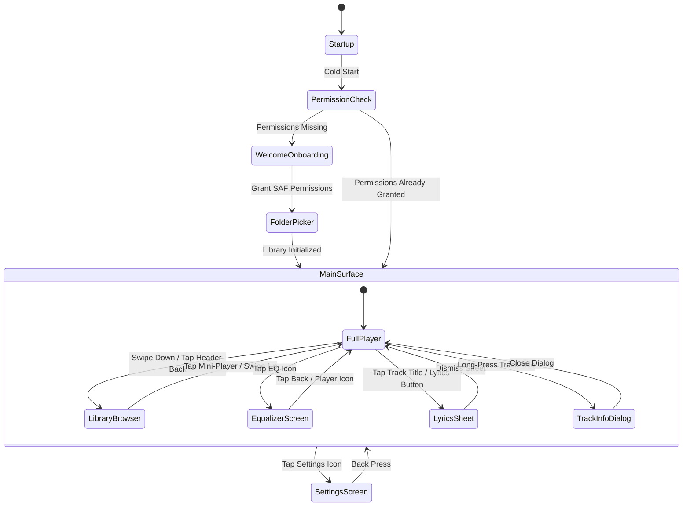
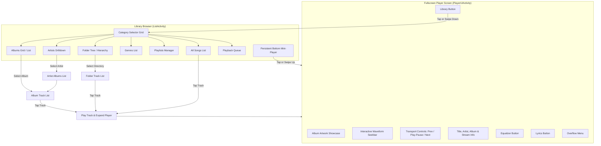
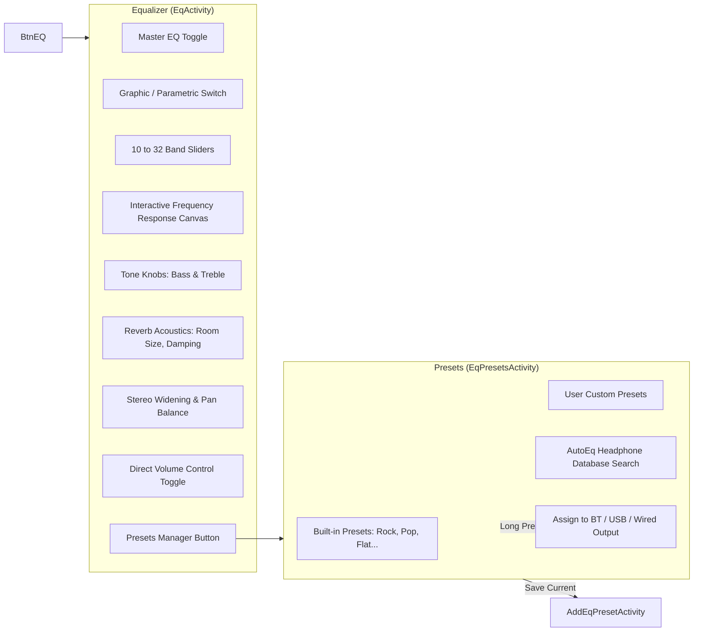
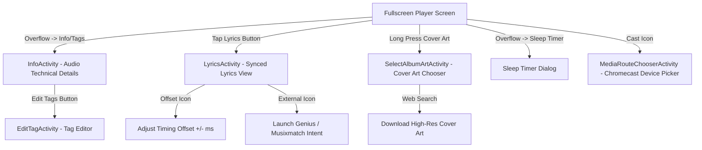

# 06 — Navigation Flow & State Architecture

## 1. Top-Level Application State Machine

The application transitions through three main visual layers:
1. **Cold Start & Onboarding Layer**: `StartupActivity` -> `WelcomeActivity` / Storage Permissions -> `MainActivity`.
2. **Main Application Surface**: Dual-pane / sliding sheet container alternating between **Fullscreen Player Screen** and **Library Browser Hierarchy**.
3. **Dedicated Auxiliary Overlays**: Modal sheets for Equalizer, Lyrics, Metadata Tag Editor, and Settings.

---

## 2. Main Player & Library Navigation Flow

---

## 3. Equalizer & DSP Navigation Flow

---

## 4. Modal Dialogs & Sheets Hierarchy

All dialogs in the application extend `BaseDialogActivity`, rendering as elevated modal cards with dimming behind the content:

---

## 5. Touch Gestures & Physical Key Controls

| Gesture / Physical Input | Context | Resulting Action |
| :--- | :--- | :--- |
| **Horizontal Swipe on Cover Art** | Player Screen | Next Track (Swipe Left) / Previous Track (Swipe Right) |
| **Vertical Swipe on Cover Art** | Player Screen | Next Category/Album (Swipe Down) / Previous Category (Swipe Up) |
| **Swipe Down on Player Screen** | Player Screen | Minimize player to bottom mini-player and reveal Library |
| **Swipe Up on Mini-Player** | Library Screen | Expand mini-player into Fullscreen Player Screen |
| **Pinch-to-Zoom** | Library Grid / List | Adjust grid column count (1 to 6 columns) and item zoom |
| **Rotary Drag on Knobs** | Equalizer / Tone | Adjust Bass, Treble, Balance, and Frequency values with haptic clicks |
| **Long-Press Track Item** | Any Track List | Show Context Action Sheet (Enqueue, Play Next, Info, Add to Playlist, Delete) |
| **Headset Media Button Single Click** | Background / Foreground | Play / Pause toggle |
| **Headset Media Button Double Click** | Background / Foreground | Next track |
| **Headset Media Button Triple Click** | Background / Foreground | Previous track |
| **Long-Press Volume Buttons (Screen Off)** | Locked / Screen Off | Skip forward / backward (`SET_VOLUME_KEY_LONG_PRESS_LISTENER`) |
