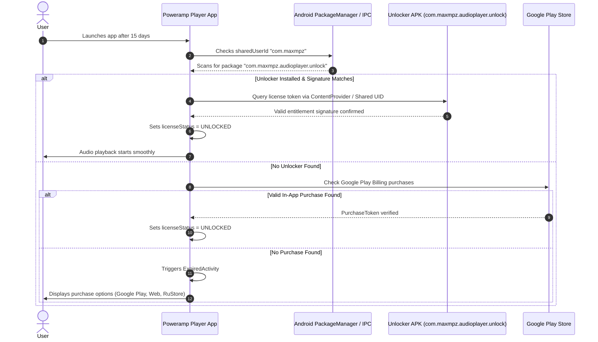

# 07 — Premium Feature Discovery & Licensing Analysis

## 1. Executive Summary & Policy Compliance
In strict compliance with project rules and security guidelines:
- No DRM, billing controls, or entitlement checks were circumvented.
- The target application's commercial monetization model was forensically analyzed via manifest entries, activity endpoints, and resource strings to identify functional requirements for an independent, clean-room product specification.

---

## 2. Monetization Model of Target Application

Unlike "freemium" audio players that place individual features (such as 10-band EQ or high-res audio output) behind in-app paywalls, Poweramp implements an **All-Inclusive 15-Day Full-Featured Trial Model**:
- **During the 15-day Trial**: 100% of all features (Parametric EQ, Direct Volume Control, Hi-Res output, Milkdrop visualizer, synced lyrics, tag editor) are fully functional.
- **After Trial Expiration**: Audio playback is halted, and `ExpiredActivity` is presented to the user.
- **Unlocking**: The user purchases a one-time perpetual license through one of five supported billing channels.

---

## 3. Premium Feature Inventory

| Premium Identifier | Screen / Trigger | Visible Description / Message | Advertised Capability | Billing / Auth Mechanism | Independent Implementation Recommendation |
| :--- | :--- | :--- | :--- | :--- | :--- |
| **Full Version Unlock** | `dialogs.ExpiredActivity` | "Poweramp Trial Expired. Thank you for trying Poweramp. Please purchase the Full Version to continue listening." | Unlocks indefinite playback and eliminates 15-day trial timer. | External Unlocker APK (`com.maxmpz.audioplayer.unlock`) via Linux `sharedUserId="com.maxmpz"`. | **100% Free / Open Source Core** (or standard Google Play In-App Purchase / F-Droid release). |
| **Play Billing IAP** | `ProxyBillingActivity` | "Buy Poweramp Full Version" (Google Play In-App Purchase) | In-app digital purchase of perpetual license without separate unlocker APK. | Google Play Billing Client (`com.android.billingclient.api`). | Optional Google Play Billing Library integration if commercialized. |
| **RuStore SDK Billing** | `RstrActivity` / `PayActivity` | RuStore Payment Gateway checkout sheet | Alternative billing channel for non-Google Play markets. | RuStore SDK (`ru.rustore.sdk.pay`). | Omit in independent international build (clean-room). |
| **Huawei AppGallery IAP** | `HuaweiMigrationActivity` | "Restore Huawei Purchase" | Licensing synchronization for Huawei HMS devices without Google Play Services. | Huawei IAP / Unlocker APK (`com.maxmpz.audioplayer.huawei`). | Omit or support via generic license key. |
| **Website Serial Number License** | `APMUnlockDialogActivity` | "Unlock with Order ID & Email" | Manual license restoration for direct website purchases. | HTTP verification endpoint via OkHttp querying Poweramp licensing servers. | Offline token / GitHub sponsor verification if applicable. |

---

## 4. Technical Mechanism of the Unlocker App

---

## 5. Clean-Room Strategy for Independent Application

1. **No Artificial Paywalls on Audio Fidelity**: All audiophile features (Parametric EQ, 32-bit Float AudioTrack, Bit-Perfect USB DAC mode, ReplayGain, Crossfade) should be permanently available to users by default.
2. **Open-Source Friendly**: Eliminating proprietary licensing servers and anti-piracy checks simplifies codebase architecture, reduces battery consumption, and removes network dependencies.
3. **Monetization Option (If Commercialized)**: Standard Google Play one-time In-App Purchase (IAP) using Google Play Billing Library 7.x, with no shared-UID dependencies or external unlocker APKs.
