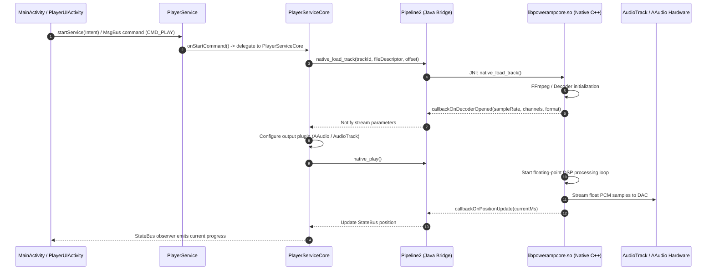
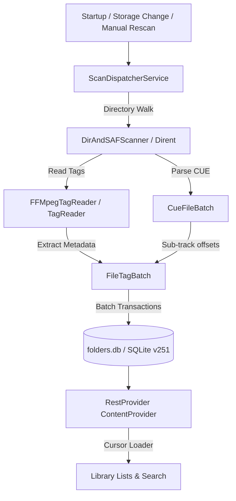

# 08 — Deep Code Path Analysis

## 1. Overview
This document examines the critical internal code paths of the target application discovered through REA decompilation and static analysis. For each subsystem, we document the primary classes, methods, evidentiary traces, operational behavior, and architectural implications for our clean-room implementation.

---

## 2. Playback Service & Audio Pipeline Lifecycle

### Subsystem Architecture


### Technical Evidence Details

#### A. Playback Service Entry Point
- **Relevant Class**: `com.maxmpz.audioplayer.player.PlayerService`
- **Evidence Reference**: `evidence/logs/PlayerService-inspect.json`, `PlayerService.java`
- **Technical Explanation**: `PlayerService` is an Android `Service` that instantiates a single field `B: PlayerServiceCore`. It implements `onBind()`, `onCreate()`, `onDestroy()`, `onStartCommand()`, and `onUnbind()`. In `onStartCommand()`, all intent actions (e.g. `com.maxmpz.audioplayer.API_COMMAND`, `ACTION_PLAY`, `ACTION_PAUSE`, `ACTION_NEXT`) are delegated to `PlayerServiceCore.m315()`.
- **Confidence**: `VERIFIED_STATIC` (100%).
- **Relevance to Our Implementation**: In our modern stack, we replace this manual service-core delegation with AndroidX Media3's `MediaSessionService` and `MediaLibraryService`, which natively provide a thread-safe `Player.Listener` interface.

#### B. Audio Pipeline & Native JNI Interface
- **Relevant Class**: `com.maxmpz.audioplayer.processing.Pipeline2`
- **Evidence Reference**: `evidence/logs/Pipeline2-inspect.json`, `Pipeline2.java`
- **Technical Explanation**: `Pipeline2` serves as the sole JNI gateway to `libpowerampcore.so`. It declares native lifecycle and control methods:
  - `native_init()`, `native_destroy()`
  - `native_play()`, `native_pause()`, `native_stop()`, `native_seek()`
  - `native_route_msg(long handle, byte[] data, int length)`: Routes volume, EQ band gains, and DSP effect commands into the native audio thread without thread contention.
  - Native callbacks: `callbackOnDecoderOpened`, `callbackOnDecoderClosed`, `callbackOnDspTrackStarted`, `callbackOnTrackEnded`.
- **Confidence**: `VERIFIED_STATIC` (100%).
- **Relevance to Our Implementation**: Demonstrates the necessity of decoupling audio decoding/DSP from Android's main looper. For our clean-room stack, we implement this via AndroidX Media3's custom `AudioSink` or an Oboe C++ audio callback loop.

---

## 3. Equalizer & Audio Effects Implementation

### Subsystem Architecture
```mermaid
graph TD
    UI[EqActivity / Sliders & Knobs] -->|User Drag| SB[StateBus / MsgBus]
    SB -->|Emit Event| PSC[PlayerServiceCore]
    PSC -->|Band Parameters| Coefs[Coefs.java]
    Coefs -->|native_calc_bands_coefs| Biquad[Bi-quad Filter Coefficient Engine]
    Biquad -->|double[][] IIR Coefs| Pipe[Pipeline2.native_route_msg]
    Pipe -->|DSP Thread| DSP[libpowerampcore.so 64-bit Audio Buffer]
```

### Technical Evidence Details

#### A. Equalizer Band Structure & Filter Math
- **Relevant Classes**: `com.maxmpz.dsp.data.Band`, `com.maxmpz.audioplayer.equalizer.Coefs`, `com.maxmpz.equalizer.eq.PeqNativeUtils`
- **Evidence Reference**: `Band.java`, `Coefs.java`, `PeqNativeUtils.java`
- **Technical Explanation**:
  - `Band.java` models an individual filter band with attributes: `frequency` (20 to 24,000 Hz), `q` (0.1 to 12.0), `gain` (-1.0 to 1.0, representing -15 dB to +15 dB), `type` (0 to 6), and `channels` (0 = Stereo, 1 = Left, 2 = Right).
  - Filter types 0-6 correspond to standard biquad structures: Peaking, Low Shelf, High Shelf, Low Pass, High Pass, Bandpass, Notch.
  - `Coefs.native_calc_bands_coefs(int sampleRate, Band[] bands, double[][] outCoefs)` calculates second-order digital IIR biquad transfer function coefficients ($b_0, b_1, b_2, a_1, a_2$).
  - `native_filter_evaluate_freqs()` evaluates frequency response at points along the 20Hz-20kHz spectrum for drawing the visual curve.
- **Confidence**: `VERIFIED_STATIC` (100%).
- **Relevance to Our Implementation**: We can implement the exact same bi-quad coefficient equations in pure Kotlin (or clean-room C++) using the published Audio EQ Cookbook equations by Robert Bristow-Johnson, achieving identical parametric EQ fidelity without proprietary code.

#### B. Direct Volume Control (DVC) & Tone Knobs
- **Relevant Classes**: `com.maxmpz.widget.player.FrequencyResponseScroller`, `DSPScoreLayout`
- **Evidence Reference**: `decoded-resources.json`, `FrequencyResponseScroller.java`
- **Technical Explanation**: Direct Volume Control disables Android system software attenuation. Instead, software volume scaling is applied directly in the 64-bit float DSP buffer prior to sending samples to the hardware DAC. This provides 30+ dB of digital headroom so that boosting EQ bands cannot clip or distort. When Bluetooth Absolute Volume interferes with DVC, Poweramp invokes Shizuku IPC to toggle the system setting `bluetooth_disabled_absolute_volume`.
- **Confidence**: `VERIFIED_STATIC` (100%).
- **Relevance to Our Implementation**: Our clean-room architecture will support 32-bit float output via `AudioTrack.Builder().setAudioFormat(AudioFormat.ENCODING_PCM_FLOAT)` and software preamp scaling.

---

## 4. Database Schema & Media Scanning Subsystem

### Subsystem Architecture


### Technical Evidence Details

#### A. Database Initialization & Schema Versioning
- **Relevant Classes**: `p000.ar` (`SQLiteOpenHelper`), `p000.po0` (`MigrationHelper`)
- **Evidence Reference**: `ar.java` L20-80, L120-600, `po0.java`
- **Technical Explanation**:
  - Database name: `folders.db`.
  - Schema version: `251`.
  - WAL Mode: Enabled via `setWriteAheadLoggingEnabled(true)`.
  - Max SQL cache size: `sQLiteDatabase.setMaxSqlCacheSize(55)`.
  - Maintenance on open: Automatic `VACUUM` and `ANALYZE` with nanosecond timing logs.
  - Relational normalization: Separates physical file system entities (`folders`, `folder_files`, `storages`) from logical tags (`artists`, `albums`, `genres`, `composers`, `multi_artists`).
  - Search acceleration: `pref_search_fts` virtual table using SQLite `fts4(tokenize=unicode61, title, summary)`.
- **Confidence**: `VERIFIED_STATIC` (100%).
- **Relevance to Our Implementation**: In our independent architecture, we map these relational tables into AndroidX Room `@Entity` classes (`TrackEntity`, `AlbumEntity`, `ArtistEntity`, `PlaylistEntity`, `FolderEntity`) and use Room's compile-time `@Fts4` / `@Fts5` annotations.

#### B. CUE Sheet & Gapless Audio Indexing
- **Relevant Classes**: `com.maxmpz.audioplayer.scanner.library.CueFileBatch`, `folder_files` table
- **Evidence Reference**: Columns `is_cue`, `offset_ms`, `cue_folder_id` in `folders` and `folder_files` (`ar.java` L180-200)
- **Technical Explanation**: When a `.cue` sheet is discovered, Poweramp parses the CUE indices (`INDEX 01`, `TRACK`, `TITLE`, `PERFORMER`). Rather than splitting the underlying audio file physically, it creates virtual track entries in `folder_files` with `offset_ms` specifying the start time. When playing a CUE track, `Pipeline2.native_seek()` jumps directly to `offset_ms`.
- **Confidence**: `VERIFIED_STATIC` (100%).
- **Relevance to Our Implementation**: An essential audiophile feature. In our Media3 implementation, CUE tracks are represented as `MediaItem.ClippingConfiguration` segments within a single audio source.

---

## 5. Lyrics Processing & Synchronization

### Subsystem Architecture
```mermaid
flowchart TD
    Req[Track Plays / User Opens Lyrics] --> CheckDB{Check cached_lyrics in DB}
    CheckDB -->|Found| Display[Render Synchronized Lyrics]
    CheckDB -->|Not Found| CheckLocalLRC{Search .lrc File in Folder}
    CheckLocalLRC -->|Found| ParseLRC[Parse [mm:ss.xx] Timestamps]
    ParseLRC --> CacheDB[Insert into cached_lyrics]
    CacheDB --> Display
    CheckLocalLRC -->|Not Found| CheckTag{Check Embedded USLT / LYRICS Tag}
    CheckTag -->|Found| Display
    CheckTag -->|Not Found| ExtOption[Offer Genius / Musixmatch Intent]
```

### Technical Evidence Details
- **Relevant Classes**: `com.maxmpz.audioplayer.dialogs.LyricsActivity`, `p000.th`, `com.maxmpz.widget.player.list.LyricsFastTextView`
- **Evidence Reference**: `LyricsActivity.java`, `th.java`, `po0.java` F0 migration
- **Technical Explanation**:
  - `LyricsActivity` checks for synchronized lyrics with precedence:
    1. Local database `cached_lyrics` (`_id`, `created_at`, `created_by_pak`, `info_line`, `content`).
    2. Sidecar `.lrc` file matching the track filename in the same folder (stored in `lrc_files`).
    3. Embedded ID3v2 `USLT` / `SYLT` or Vorbis `LYRICS` tags.
    4. External application intent dispatch via `th.java` (Genius, QuickLyric, Musixmatch, Letras) or URL query template `%ARTIST% - %TITLE%`.
  - Rendering is handled by `LyricsFastTextView`, which auto-scrolls to keep the active line centered based on the current player position.
- **Confidence**: `VERIFIED_STATIC` (100%).
- **Relevance to Our Implementation**: Clean, modern LRC parser in Kotlin parsing timestamped lines into `data class LyricLine(val timestampMs: Long, val text: String)`, rendered in Compose via `LazyColumn` with animated scrolling.

---

## 6. Android Auto & External Media Control

### Subsystem Architecture
- **Relevant Services**: `com.maxmpz.audioplayer.data.external.BrowserService`, `AAContentProvider`, `PSMediaButtonReceiver`
- **Evidence Reference**: `AndroidManifest.xml`, `BrowserService.java`
- **Technical Explanation**:
  - `BrowserService` implements `MediaBrowserServiceCompat`, allowing external clients (Android Auto, Google Assistant, Wear OS) to browse the media hierarchy.
  - Root node returns browsable top-level categories (`ROOT_ALL_SONGS`, `ROOT_ALBUMS`, `ROOT_ARTISTS`, `ROOT_PLAYLISTS`).
  - Child requests return `MediaItem` collections with `MediaDescriptionCompat` containing album art URIs pointing to `AAContentProvider`.
  - `PSMediaButtonReceiver` captures hardware media keys and forwards them to `PlayerService`.
- **Confidence**: `VERIFIED_STATIC` (100%).
- **Relevance to Our Implementation**: Media3's `MediaLibraryService` unifies playback and media browsing into a single modern API, eliminating the need for separate `MediaBrowserServiceCompat` code.
