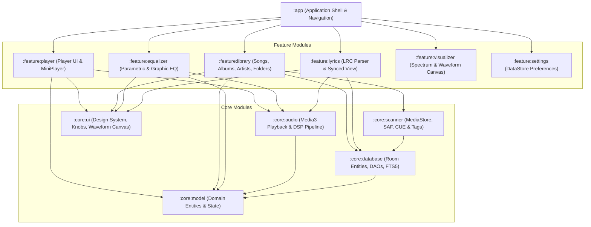
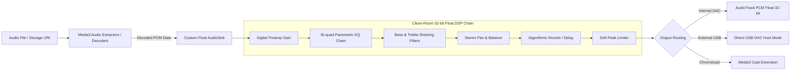
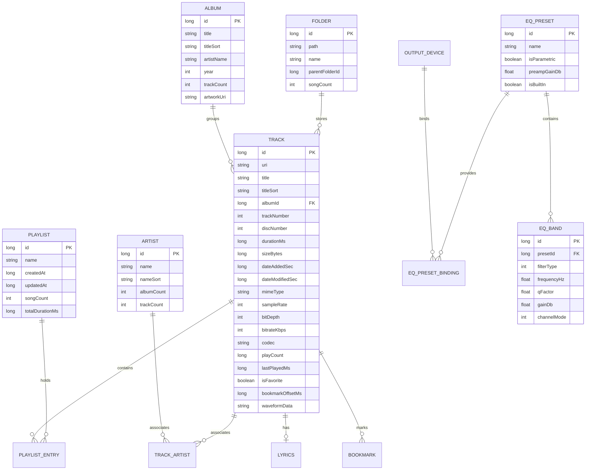
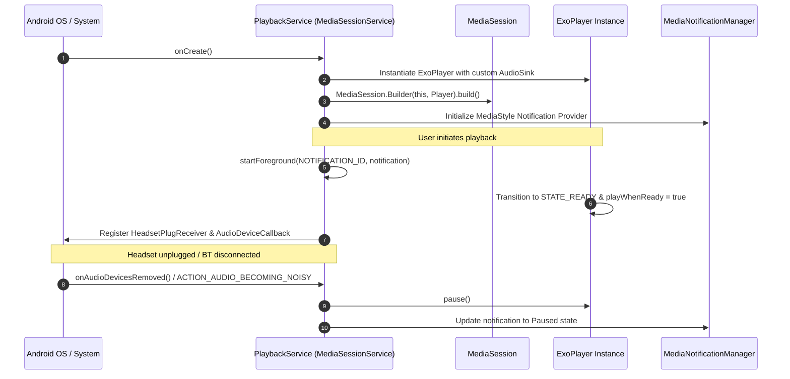

# 10 — Independent Clean-Room Architecture Specification

## 1. Architectural Principles & Design Goals
The goal of this architecture is to design a high-fidelity, production-grade, independently maintainable Android native music player. The architecture adheres to:
1. **Clean-Room Engineering**: Completely zero reliance on proprietary code, reverse-engineered binaries, or unlicensed assets.
2. **Modern Android Standards**: 100% Kotlin, Jetpack Compose, AndroidX Media3, Room, Hilt, and Coroutines/Flow.
3. **Audiophile-Grade Audio Reproduction**: 32-bit floating-point PCM audio pipeline, low-latency playback, custom Parametric EQ, gapless playback, and bit-perfect DAC output.
4. **Offline-First & Privacy-Centric**: Zero mandatory network calls, no analytics trackers, no advertising SDKs, full local database autonomy.

---

## 2. Multi-Module System Topology

---

## 3. Module Responsibilities

| Module | Core Responsibility | Key Technologies |
| :--- | :--- | :--- |
| `:app` | Application entry point, Hilt dependency root, Compose navigation graph | Hilt, Navigation Compose |
| `:core:audio` | MediaSessionService, AudioTrack float playback, DSP filter chain, volume control | AndroidX Media3, AudioTrack Float, Biquad DSP |
| `:core:database` | Relational SQLite persistence, indexing, FTS5 full-text search, DAOs | Room 2.6+, SQLite WAL |
| `:core:scanner` | Library ingestion, MediaStore sync, SAF folder walk, CUE sheet splitting, ID3 tag extraction | WorkManager, MediaStore, SAF, JAudioTagger/TagLib |
| `:core:ui` | Design system, typography, color palette, custom rotary knobs, interactive waveform canvas | Jetpack Compose, Material 3, Canvas API |
| `:core:model` | Pure Kotlin domain models (Track, Album, Artist, Playlist, EqBand, Lyrics) | Kotlin Data Classes, Kotlinx Serialization |
| `:feature:player` | Fullscreen player screen, sliding mini-player, transport controls | Jetpack Compose, Compose Animation |
| `:feature:library` | Catalog lists and grids (Songs, Albums, Artists, Genres, Folders, Queue) | Compose LazyColumn / LazyVerticalGrid |
| `:feature:equalizer`| Graphic sliders, parametric curve canvas, tone knobs, reverb acoustic presets | Custom Compose Gestures & Path Rendering |
| `:feature:lyrics` | Synced LRC line renderer, time offset adjuster, local lyric cache | Compose LazyListState auto-scroll |
| `:feature:visualizer`| FFT audio spectrum analyzer, waveform oscilloscope | Android Visualizer API, Canvas / OpenGL ES |
| `:feature:settings`| Settings hierarchy, audio output selector, theme customizer, backup/restore | Jetpack DataStore Preferences |

---

## 4. Audio Playback Pipeline Architecture

### Digital Filter Mathematics (Parametric EQ)
Each band of the parametric equalizer is evaluated as a standard second-order direct-form II transposed biquad IIR digital filter:

$$H(z) = \frac{b_0 + b_1 z^{-1} + b_2 z^{-2}}{a_0 + a_1 z^{-1} + a_2 z^{-2}}$$

The filter coefficients ($b_0, b_1, b_2, a_0, a_1, a_2$) are computed in clean-room Kotlin using the standard Robert Bristow-Johnson Audio EQ Cookbook algorithms parameterized by:
- $F_s$: Current audio sample rate (e.g. 44,100 Hz, 48,000 Hz, 96,000 Hz, 192,000 Hz).
- $f_0$: Center frequency in Hz (20 Hz to 20,000 Hz).
- $Q$: Quality factor (0.1 to 12.0).
- $dBgain$: Gain in decibels (-15.0 dB to +15.0 dB).

---

## 5. Relational Database Schema Proposal (Room)

---

## 6. Background Playback & Lifecycle Service

---

## 7. Media Ingestion & Scanner Architecture

1. **MediaStore Observer**:
   - `ContentObserver` registers on `MediaStore.Audio.Media.EXTERNAL_CONTENT_URI`.
   - Incremental diffing: Detects newly added or deleted files instantly without walking the storage tree.
2. **SAF / WorkManager Direct Scanner**:
   - For user-selected folders on SD cards or internal directories, a periodic or on-demand `CoroutineWorker` scans files.
   - Extracts embedded tags via lightweight ID3/Vorbis reader.
   - Discovers adjacent `.lrc` and `.cue` files.
   - Generates and stores 100-point RMS waveform arrays for the visual seekbar.

---

## 8. Battery & Performance Optimization Strategy

1. **Audio Decoding Offload**: Utilize platform hardware decoders via MediaCodec where supported to minimize CPU wake time.
2. **Zero Polling in Service Loop**: All state changes propagate reactively via Kotlin `StateFlow` and `SharedFlow`.
3. **Lazy UI Rendering**: Jetpack Compose `LazyColumn` and `LazyVerticalGrid` recycling memory for libraries with 10,000+ tracks.
4. **Artwork Memory & Disk Caching**: Coil 3-tier cache (Bitmap Memory Cache -> Disk File Cache -> Raw Audio Extraction) prevents repetitive decoding of embedded JPEG/PNG tags.
5. **WakeLock Discipline**: Acquire `PARTIAL_WAKE_LOCK` strictly when `playWhenReady == true` and release immediately when paused.
