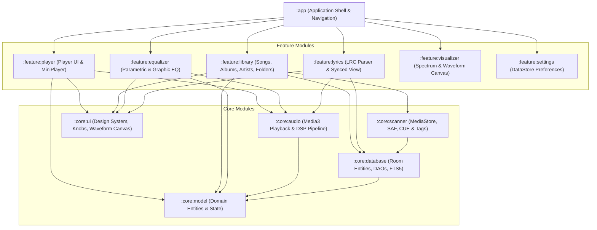
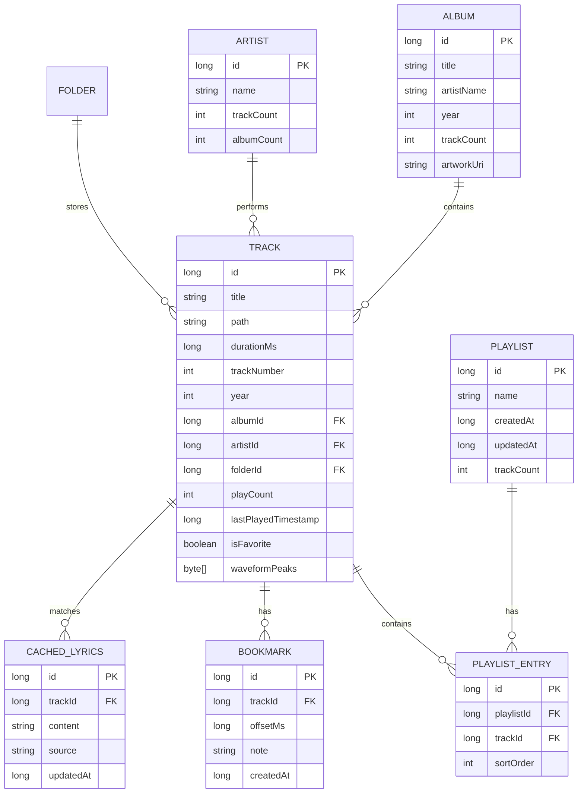

# 10 — Independent Clean-Room Architecture Specification

## 1. Architectural Principles & Design Goals
The goal of this architecture is to design a high-fidelity, production-grade, independently maintainable Android native music player. The architecture adheres to:
1. **Clean-Room Engineering**: Completely zero reliance on proprietary code, reverse-engineered binaries, or unlicensed assets.
2. **Modern Android Standards**: 100% Kotlin, Jetpack Compose, AndroidX Media3, Room, Hilt, and Coroutines/Flow.
3. **Audiophile-Grade Audio Reproduction**: 32-bit floating-point PCM audio pipeline, low-latency playback, custom Parametric EQ, gapless playback, and bit-perfect pass-through mode for external USB DACs (when DSP effects are bypassed).
4. **Offline-First & Privacy-Centric**: Zero mandatory network calls, no analytics trackers, no advertising SDKs, full local database autonomy.

---

## 2. Multi-Module System Topology

---

## 3. Module Responsibilities

| Module | Core Responsibility | Key Technologies |
| :--- | :--- | :--- |
| `:app` | Application entry point, Hilt dependency root, Compose navigation graph | Hilt, Navigation Compose |
| `:core:audio` | MediaSessionService, AudioTrack float playback, DSP filter chain, volume control | AndroidX Media3, AudioTrack Float, Biquad DSP |
| `:core:database` | Relational SQLite persistence, indexing, FTS5 full-text search, DAOs | Room 2.6+, SQLite WAL |
| `:core:scanner` | Library ingestion, MediaStore sync, SAF folder walk, CUE sheet splitting, ID3 tag extraction | WorkManager, MediaStore, SAF, JAudioTagger/TagLib |
| `:core:ui` | Design system, typography, color palette, custom rotary knobs, interactive waveform canvas | Jetpack Compose, Material 3, Canvas API |
| `:core:model` | Pure Kotlin domain models (Track, Album, Artist, Playlist, EqBand, Lyrics) | Kotlin Data Classes, Kotlinx Serialization |
| `:feature:player` | Fullscreen player screen, sliding mini-player, transport controls | Jetpack Compose, Compose Animation |
| `:feature:library` | Catalog lists and grids (Songs, Albums, Artists, Genres, Folders, Queue) | Compose LazyColumn / LazyVerticalGrid |
| `:feature:equalizer`| Graphic sliders, parametric curve canvas, tone knobs, reverb acoustic presets | Custom Compose Gestures & Path Rendering |
| `:feature:lyrics` | Synced LRC line renderer, time offset adjuster, local lyric cache | Compose LazyListState auto-scroll |
| `:feature:visualizer`| FFT audio spectrum analyzer, waveform oscilloscope | Android Visualizer API, Canvas / OpenGL ES |
| `:feature:settings`| Settings hierarchy, audio output selector, theme customizer, backup/restore | Jetpack DataStore Preferences |

---

## 4. Evaluation of Three Independent Audio Architectures

In compliance with Phase 1.1 architectural validation, we rigorously evaluate three candidate architectures:
- **Architecture A**: Media3-First (Standard AndroidX Media3 / ExoPlayer with default AudioSink and framework `AudioEffect`).
- **Architecture B (Recommended)**: Hybrid — Media3 Decoding with Custom 32-bit Float DSP Pipeline and High-Res AudioTrack Output.
- **Architecture C**: Fully Custom Native Audio Pipeline (C++ / Oboe / AAudio / FFmpeg via JNI).

### Deep Trade-Off Comparison Matrix

| Evaluation Dimension | Architecture A (Media3-First) | Architecture B (Hybrid Float DSP) | Architecture C (Native C++ / Oboe) |
| :--- | :--- | :--- | :--- |
| **Codec Support** | Standard Android codecs (MP3, AAC, FLAC, Opus) | Wide: System codecs + FFmpeg extension (APE, ALAC, DSD, WavPack) | Maximum: Custom-compiled FFmpeg NDK decoders |
| **PCM Formats** | 16-bit signed integer PCM | **32-bit float PCM (`ENCODING_PCM_FLOAT`)** | 32/64-bit float native audio ring buffers |
| **Sample-Rate Handling** | Fixed OS resampling (usually 48kHz via AudioFlinger) | Preserves source rate (44.1–192kHz) where hardware permits | Native rate selection up to 384kHz via AAudio exclusive |
| **AudioTrack Behavior** | Standard `DefaultAudioSink` | Custom `AudioSink` with float output & direct flags | Bypasses Java AudioTrack; direct AAudio/OpenSL |
| **USB DAC Compatibility** | Standard OS USB class driver | Direct routing via `AudioDeviceInfo.TYPE_USB_DEVICE` | Custom USB Host asynchronous packet streaming |
| **Audio Focus** | Built-in, fully automated by Media3 | Built-in, integrated with Media3 session | Manual implementation via JNI callbacks |
| **Gapless Playback** | Built-in ExoPlayer gapless for MP3/FLAC/Opus | Built-in with custom padding/delay trim | Manual dual-decoder buffer pre-roll in C++ |
| **Crossfade** | Not supported out-of-the-box | Clean dual-buffer mixing via custom `AudioProcessor` | Custom C++ mixing loop with linear/equal-power curve |
| **EQ Processing** | Limited framework `AudioEffect` (5-10 fixed bands) | **Full 10-32 band graphic & parametric Biquad IIR chain** | Custom C++ SIMD NEON biquad filter chain |
| **Internal Arithmetic Dynamic Span** | None (16-bit fixed integer clips at 0 dBFS) | **Scale-invariant float (>1500 dB exponent span, ~144 dB mantissa SNR)** | Scale-invariant float/double buffer math |
| **Audio Latency** | Medium (50–100ms) | Low to Medium (20–40ms) | Lowest (<10ms via AAudio exclusive mode) |
| **Battery Usage** | Lowest (Hardware DSP offloading when available) | Very Low (Optimized Kotlin/SIMD DSP math) | Moderate (Continuous native CPU wake during DSP) |
| **Device Compatibility**| 100% (Android API 21 through 35) | **99.5% (Float AudioTrack supported since API 21)** | Fragile across vendor Android forks (OEM HAL quirks) |
| **Development Complexity**| Lowest | **Moderate (Clean separation of concerns, testable)** | Extremely High (NDK, C++ ABI builds, memory hazards) |
| **Licensing Risks** | None (Apache 2.0) | **Zero proprietary risk (Apache 2.0 / MIT)** | LGPL 2.1 compliance management for FFmpeg |

---

### Critical Technical Distinctions

> [!WARNING]
> **Float PCM vs. Bit-Perfect Output**:
> 32-bit floating-point PCM (`AudioFormat.ENCODING_PCM_FLOAT`) eliminates digital clipping and rounding distortion during DSP equalization, providing immense dynamic headroom. However, **Float PCM is NOT identical to bit-perfect output**. Bit-perfect reproduction means the digital samples delivered to the DAC are mathematically identical to the source file without resampling or volume scaling. If the Android system mixer (`AudioFlinger`) or device kernel resamples 44.1kHz audio to 48kHz, the stream is no longer bit-perfect even if delivered in 32-bit float.

> [!IMPORTANT]
> **DAC Hardware Sample Rate Realities**:
> Not all USB DACs or internal smartphone DACs support arbitrary sample rates (e.g. 88.2kHz or 384kHz). An audiophile audio player must query the device's supported sample rates via `AudioDeviceInfo.getSampleRates()` and negotiate the closest integer-multiple clock (e.g. 44.1kHz -> 88.2kHz -> 176.4kHz; 48kHz -> 96kHz -> 192kHz) to avoid harmonic interpolation distortion.

### Recommended Architectural Strategy: Architecture B
Architecture B strikes the ideal balance between audiophile audio reproduction, maintainability, and clean-room independence:
1. Leverage AndroidX Media3 for rock-solid decoding, media session management, audio focus, and background notification controls.
2. Intercept the audio pipeline at the `AudioProcessor` / `AudioSink` boundary to convert samples to 32-bit float PCM.
3. Apply our independent Robert Bristow-Johnson Biquad parametric equalizer, bass/treble tone controls, stereo balance, and soft limiter.
4. Output to `AudioTrack` configured with `AudioFormat.ENCODING_PCM_FLOAT`, querying `AudioDeviceInfo` to match native DAC hardware clock rates.

---

## 5. Audio Playback Pipeline Architecture (Architecture B)

```mermaid
flowchart LR
    File[Audio File / Storage URI] --> Extractor[Media3 Audio Extractors / Decoders]
    Extractor -->|Decoded PCM Data| AudioSink[Custom Float AudioSink]
    
    subgraph DSP["Clean-Room 32-bit Float DSP Chain"]
        Preamp[Digital Preamp Gain] --> EQ[Bi-quad Parametric EQ Chain]
        EQ --> Tone[Bass & Treble Shelving Filters]
        Tone --> Balance[Stereo Pan & Balance]
        Balance --> Reverb[Algorithmic Reverb / Delay]
        Reverb --> Limiter[Soft Peak Limiter]
    end

    AudioSink --> Preamp
    Limiter --> SinkOut[AudioTrack PCM Float Output]
    SinkOut --> DAC[Device DAC / USB Interface]
```

### Digital Biquad Filter Mathematics
Every band in our 10-32 band graphic and parametric equalizer uses standard second-order IIR biquad transfer functions:

$$H(z) = \frac{b_0 + b_1 z^{-1} + b_2 z^{-2}}{a_0 + a_1 z^{-1} + a_2 z^{-2}}$$

#### Peaking EQ Filter Equations (Robert Bristow-Johnson Cookbook)
Given center frequency $f_0$, sample rate $f_s$, gain in dB $A = 10^{\text{gain}/40}$, and quality factor $Q$:

$$\omega_0 = 2\pi \frac{f_0}{f_s}, \quad \alpha = \frac{\sin(\omega_0)}{2Q}$$

$$b_0 = 1 + \alpha A, \quad b_1 = -2\cos(\omega_0), \quad b_2 = 1 - \alpha A$$
$$a_0 = 1 + \frac{\alpha}{A}, \quad a_1 = -2\cos(\omega_0), \quad a_2 = 1 - \frac{\alpha}{A}$$

All coefficients are normalized by dividing by $a_0$. Filtering is computed in Direct Form II Transposed for numerical stability.

---

## 6. Relational Database Schema (Room)

