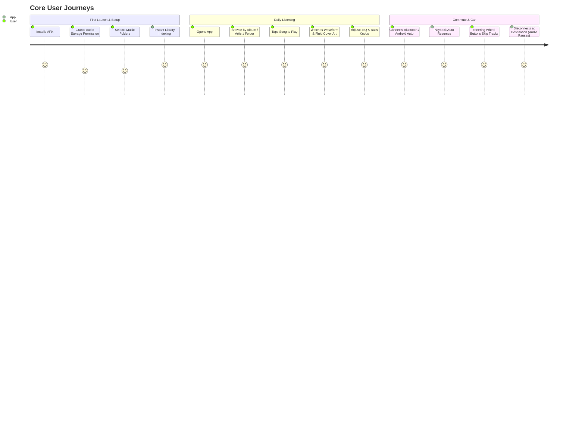

# 11 — Product Requirements Document (PRD): Independent Native Music Player

## 1. Product Vision & Value Proposition
To build the premier **clean-room, open-architecture, audiophile-grade native Android music player**. The product provides uncompromising studio sound quality, a rich parametric equalizer, smooth modern gestures, synchronized lyrics, and comprehensive local audio file management without subscriptions, telemetry, or proprietary lock-in.

---

## 2. Target Audience & Personas

1. **The Audiophile**: Demands high-fidelity reproduction, Hi-Res audio (up to 24-bit/192kHz PCM & DSD), custom Parametric EQ, AutoEq profile matching, and USB DAC bit-perfect pass-through mode (when DSP effects are bypassed).
2. **The Offline Music Collector**: Maintains personal collections of FLAC, ALAC, MP3, and CUE albums on high-capacity SD cards; requires folder hierarchy browsing, tag editing, and embedded artwork support.
3. **The Daily Commuter / Driver**: Requires seamless Bluetooth auto-resume, Android Auto integration, lock screen controls, and Quick Settings tile access.
4. **The Lyric Enthusiast**: Enjoys karaoke-style time-synchronized lyrics with fine-tuned millisecond offset adjustment.

---

## 3. Core User Journeys

---

## 4. Feature Prioritization (MoSCoW Framework)

### Must Have (P0 — Core MVP)
- High-fidelity audio playback engine (AndroidX Media3) supporting MP3, AAC, FLAC, ALAC, OGG Vorbis, OPUS, WAV.
- Persistent foreground `MediaSessionService` with modern system media notification.
- Comprehensive library views: Songs, Albums, Artists, Folders, and Playlists.
- Fast local search with incremental matching.
- Interactive waveform seekbar with smooth scrubbing.
- Basic Equalizer (10-band graphic EQ) and audio presets (Rock, Pop, Flat, etc.).
- Audio focus management (pause on incoming call, pause on headphone unplug).
- Dynamic Dark / OLED Black themes matching Material You design tokens.

### Should Have (P1 — Audiophile & Extended Features)
- Parametric Equalizer mode with arbitrary filter types (Peaking, Shelf, Pass, Notch) and Q-factor control.
- Synchronized `.lrc` and embedded tag lyrics viewer with auto-scroll.
- Separate Bass and Treble tone knobs.
- Gapless playback and user-configurable crossfade (0-10 seconds).
- Reverb acoustic simulation (Room Size, Damping, Width, Wet/Dry).
- Homescreen interactive widgets (4x1, 4x2, 2x2).
- CUE sheet virtual track parsing.
- In-app tag editor (ID3v2, Vorbis tags).
- Android Auto (`MediaLibraryService`) integration.

### Could Have (P2 — Pro Enhancements)
- AutoEq database integration for one-tap headphone frequency compensation.
- Direct USB DAC host mode with exclusive bit-perfect pass-through streaming (when DSP effects are bypassed).
- Real-time OpenGL audio spectrum visualizer.
- Custom preset binding to specific Bluetooth devices / wired outputs.
- Sleep timer with gentle volume fade-out.
- Dynamic themed launcher icons.

### Won't Have (P3 — Out of Scope for Phase 2)
- Cloud music streaming services (Spotify, Apple Music, Tidal APIs).
- Social sharing or proprietary accounts.
- Invasive analytics, telemetry, or advertisement networks.

---

## 5. Functional Requirements

| Req ID | Domain | Requirement Statement | Verification Method |
| :--- | :--- | :--- | :--- |
| **FR-01** | Playback | App must play local audio files with gapless transitions when track boundaries match. | Audio output inspection |
| **FR-02** | Playback | App must support variable playback speed (0.5x to 2.0x) and pitch adjustment. | Functional test |
| **FR-03** | Queue | User must be able to enqueue tracks ("Play Next" / "Add to Queue") without altering active playlist. | State check |
| **FR-04** | DSP | Equalizer must support +/- 15 dB gain adjustment per band across 20 Hz to 20 kHz. | DSP calculation test |
| **FR-05** | Equalizer | App must plot continuous frequency response curves reflecting combined filter gains. | UI Canvas verification |
| **FR-06** | Library | App must index 10,000+ audio tracks in under 15 seconds via MediaStore and background scanner. | Benchmark test |
| **FR-07** | Lyrics | App must parse standard `.lrc` files and scroll smoothly within 50ms of audio playback time. | Sync test |
| **FR-08** | Storage | Tag editor must update audio file headers in-place using Storage Access Framework URIs. | File metadata check |
| **FR-09** | System | Playback must pause instantly upon `ACTION_AUDIO_BECOMING_NOISY` broadcast. | Intent broadcast test |
| **FR-10** | Auto | Android Auto head-unit must receive media tree items with playable URIs and artwork. | Android Auto DHU test |

---

## 6. Non-Functional Requirements

### A. Performance & Fluidity
- **UI Frame Rate**: Constant 60 to 120 fps animations on modern high-refresh-rate displays.
- **Cold Start Time**: Under 600 milliseconds to interactive home screen.
- **Audio Output Latency**: Buffer latency under 40 milliseconds on low-latency audio paths.

### B. Memory & Resource Footprint
- **RAM Consumption**: Under 80 MB steady-state memory usage during active playback with artwork cached.
- **Battery Consumption**: Under 2% battery drain per hour of screen-off background playback.
- **CPU Utilization (Target Budget)**: Design target budget under 3% CPU utilization during 32-bit float DSP processing on ARM64 (engineering target estimate; requires empirical physical device profiling during implementation).

### C. Reliability & Robustness
- **Crash-Free Sessions**: > 99.9% target crash-free rate.
- **Corrupt File Grace**: Corrupt or unplayable audio files must log an error and gracefully advance to the next track without stopping playback service.

---

## 7. Platform Compatibility & Hardware Matrix

| Parameter | Specification Target |
| :--- | :--- |
| **Minimum Android Version** | Android 8.0 Oreo (API Level 26) — Ensures native AAudio and notification channels |
| **Target Android Version** | Android 15 / 16 (API Level 35/36) — Aligned with latest foreground service and storage mandates |
| **Architectures Supported** | `arm64-v8a`, `armeabi-v7a`, `x86_64` (for emulators and Chromebooks) |
| **Form Factors** | Phones, Tablets, Foldables, Android Auto, ChromeOS, DAPs (Digital Audio Players) |

---

## 8. Release Acceptance Criteria (Phase 1 Baseline)
1. Complete architectural specification aligned with independent clean-room principles.
2. Verified feature parity with target application's core audiophile and library features.
3. Zero dependency on proprietary Poweramp native libraries, assets, or billing code.
4. Documented modular implementation roadmap ready for Phase 2 UI/UX wireframing.
