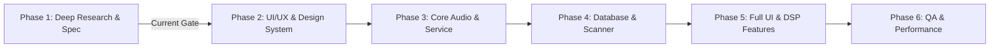

# 13 — Phased Implementation Roadmap

## 1. Project Phasing & Phase 1 Boundary Enforcement
In strict compliance with project guidelines, **Phase 1 represents research, reverse-engineering, forensic discovery, and product architecture only**. No production application code, UI scaffolding, or release build is created during this phase.

The roadmap outlines the sequential, verified stages to transition from this technical specification into a production-ready application.

---

## 2. Phase-by-Phase Execution Plan

### Phase 1: Deep APK Research & Product Discovery (Current Status: COMPLETE)
- [x] Preflight REA audit and toolchain readiness validation (JADX, Apktool, JDK 17, ADB).
- [x] APK identification, SHA-256 verification, manifest analysis.
- [x] Comprehensive class, resource, and native library forensics.
- [x] Subsystem code path analysis (Playback, Pipeline, EQ, Scanner, DB, Lyrics, Auto).
- [x] Database schema reverse engineering (251 migrations of `folders.db`).
- [x] Independent clean-room architecture specification and PRD.
- [x] Feature evidence matrix and risk assessment documentation.

---

### Phase 2: UI/UX Design System & Architectural Scaffolding (Next Phase)
- **Objective**: Establish the design system, color palettes, typography, wireframes, and component hierarchy before code implementation.
- **Key Deliverables**:
  - Material 3 Design System specification (Dynamic Dark & OLED Black palettes).
  - Screen wireframes for Player Screen, Library Hierarchy, Equalizer, and Lyrics.
  - Custom UI component blueprints:
    - Interactive 32-band Parametric EQ curve canvas.
    - Dual-color amplitude Waveform Seekbar.
    - Rotary Knobs for Volume, Bass, and Treble with haptic feedback specs.
    - Synced Lyrics layout with auto-scroll and manual offset adjusters.
  - Multi-module Gradle build scaffolding (`:core:audio`, `:core:database`, `:core:ui`, `:feature:player`, etc.).
  - Navigation flow definition using Navigation Compose.

---

### Phase 3: Core Audio Engine & Playback Service
- **Objective**: Implement the persistent foreground audio playback engine.
- **Key Deliverables**:
  - AndroidX Media3 `MediaSessionService` implementation (`PlaybackService`).
  - Audio focus and device disconnect listener (`ACTION_AUDIO_BECOMING_NOISY`).
  - MediaStyle notification with playback controls and dynamic artwork.
  - Custom 32-bit float PCM `AudioSink` utilizing `AudioTrack.Builder()`.
  - Media3 FFmpeg decoder extension for ALAC, APE, OPUS, and DSD support.
  - Unit tests verifying audio state machine, focus transitions, and error handling.

---

### Phase 4: Database, Storage & Media Scanner Pipeline
- **Objective**: Build the local persistence layer and media ingestion engine.
- **Key Deliverables**:
  - Room 2.6+ database schema (`TrackEntity`, `AlbumEntity`, `ArtistEntity`, `PlaylistEntity`, `FolderEntity`).
  - SQLite FTS5 virtual table for millisecond-latency fuzzy library search.
  - Storage Access Framework (SAF) folder picker and recursive `DocumentFile` traversal.
  - `MediaStore.Audio` content observer for automatic file synchronization.
  - CUE sheet parser generating virtual track segments.
  - Audio metadata tag extractor and in-place tag writer.
  - Automatic `.lrc` lyrics file discovery and pairing.

---

### Phase 5: Full UI Implementation & Advanced DSP Integration
- **Objective**: Connect the Compose UI layers to the audio engine and database.
- **Key Deliverables**:
  - Fullscreen Player screen with animated cover art transitions and interactive waveform.
  - Library browsing screens with smooth lazy list/grid recycling.
  - 10-to-32 band Parametric Equalizer with custom biquad IIR filter engine.
  - Bass & Treble tone shelving filters and algorithmic reverb.
  - Synced lyrics viewer with millisecond offset adjustment.
  - Android Auto `MediaLibraryService` tree projection.
  - Homescreen widgets using Jetpack Glance.

---

### Phase 6: QA, Performance Profiling & Release Acceptance
- **Objective**: Validate performance, memory, battery, and stability across real devices.
- **Key Deliverables**:
  - Audio latency and glitch profiling under high CPU load.
  - Battery consumption benchmarking during screen-off background playback (< 2%/hr target).
  - Memory leak analysis using LeakCanary.
  - Large library stress test (indexing and searching 50,000+ tracks).
  - Google Play policy and Android Auto certification audit.
  - Final signed release build preparation.
